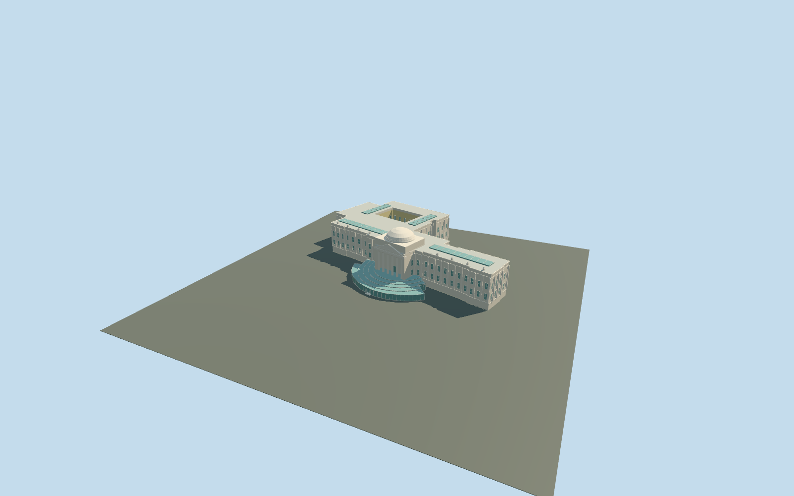

# Brooklyn Museum

Connected Brooklyn Museum exterior: exact parent/part footprint, long pale Beaux-Arts wings and rear ranges, picture-led open rear court, six-column Ionic portico/recessed upper doorway, supported triangular pediment and abstract relief/roof ornament, square attic and shallow stone dome, flat roof/skylights and the curved stepped glass entrance pavilion. Pavilion has a real central recessed lower door, soffit and threshold; glass is an opaque reflected exterior proxy. Outer terraced landscape, fountains, garden collections, temporary exhibition banners, freestanding art, furnished rooms and copied sculpture/inscriptions remain outside this model. Two short exterior treads bridge the approximate 0.4m native threshold grade.

## Evidence and reconstruction

Published dimensions and reconstructed details are separated in spec.json. Primary references:

- [Reference](https://commons.wikimedia.org/wiki/File:Brooklyn_Museum_-_Entrance_(52302265063).jpg)
- [Reference](https://www.timeout.com/newyork/news/the-brooklyn-museum-will-celebrate-its-200th-birthday-this-year-020124)

Connected Brooklyn Museum exterior: exact parent/part footprint, long pale Beaux-Arts wings and rear ranges, picture-led open rear court, six-column Ionic portico/recessed upper doorway, supported triangular pediment and abstract relief/roof ornament, square attic and shallow stone dome, flat roof/skylights and the curved stepped glass entrance pavilion. Pavilion has a real central recessed lower door, soffit and threshold; glass is an opaque reflected exterior proxy. Outer terraced landscape, fountains, garden collections, temporary exhibition banners, freestanding art, furnished rooms and copied sculpture/inscriptions remain outside this model. Two short exterior treads bridge the approximate 0.4m native threshold grade.

## Model and axes

26,486 triangles; 79,306 vertices; 7 material groups; 3,177,176 bytes. Native bounds: -81.574, -3.516, -23.282 to 79.993, 39.200, 110.221. Source hash: `sha256:0fd3af5f8577844c45c3f1977ecadd3c7efd015bd8de71ff430771c99555b0c4`.

{"x":"east","y":"up","z":"south"}

The geographic proposal uses exact-QID OpenStreetMap evidence. Map-derived orientation and estimated architectural details require real-site visual review; preview eligibility is distinct from geographic/fidelity approval. Map attribution: © OpenStreetMap contributors, ODbL-1.0.

## Reproduce

Run `node packages/worldgen/scripts/generate-additional-landmarks.mjs --ids=N0766` (or add `--check`). The generator preserves manually edited masters by checking their baseline hashes. Import through the standard authored-model workflow with optimization disabled; then capture all QA cameras, including shared-surface views.

## Pending work

- Connected Brooklyn Museum exterior: exact parent/part footprint, long pale Beaux-Arts wings and rear ranges, picture-led open rear court, six-column Ionic portico/recessed upper doorway, supported triangular pediment and abstract relief/roof ornament, square attic and shallow stone dome, flat roof/skylights and the curved stepped glass entrance pavilion. Pavilion has a real central recessed lower door, soffit and threshold; glass is an opaque reflected exterior proxy. Outer terraced landscape, fountains, garden collections, temporary exhibition banners, freestanding art, furnished rooms and copied sculpture/inscriptions remain outside this model. Two short exterior treads bridge the approximate 0.4m native threshold grade.
- Q632682 and named parent way1432069915/native35185804158747 identify Brooklyn Museum; integral main-body part way250229991/native35184622318823 is also owned. Only these two overlapping records are replaced. The mapped curved pavilion and connected wing outline supply meter scale. Origin is the midpoint of the historic portico front edge; internal +X follows the facade west-northwest and +Z points north-northeast toward Eastern Parkway. Native east/up/south axes are baked with heading 0. The rear court is visible in the ordinary aerial but not opened in this map polygon: its 35x25m rectangle is an explicit picture-led approximation, kept open in geometry and terrain.
- Medium-fi picture-led exterior. The single unqualified 50m map height is not used as a surveyed measurement. Working main roof 26m, upper portico floor 5.1m, six tapered Ionic columns to22.8m, pediment peak30m, square attic31.2m and shallow stone dome to39m above floor. Pavilion uses five descending concentric glass-roof bands approximately6.4..4.4m above floor. Rear court dimensions/placement, heights, bay counts, hidden faces, roof equipment, statue/relief abstractions and roof junctions are approximate. Two current ordinary pictures establish main colors/silhouette; no exhibition banners, copied artworks, furnished galleries or costly transparent/refraction materials. The two reconstructed 0.18m exterior treads are a working fit to the original standard approach, not surveyed historic steps.
- Qualified approximate native exterior fit on original Protomaps20261020/Mapzen 201x201 / 6m ground. Open front provider[0,36] supplies 48.12656157087435m datum. Boundary grades -3.336..+1.678m, floor +0.2m and closed foundation -3.516m. Native views show supported museum/pavilion with low-side plinth exposure and uphill base burial; the rear court and outer approaches retain original ground. Two short reconstructed 0.18m treads bridge the roughly0.4m lower-door threshold above approach ground -0.132m. Exact pavilion/terrace grades, archaeological/historic court paving, thresholds and accessibility remain unverified. No bespoke terrain or flattening.

This bundle follows the medium-fi standard. Medium-fi appearance and geographic fit are reviewed separately. Hash-bound visual acceptance is recorded separately after capture inspection.
