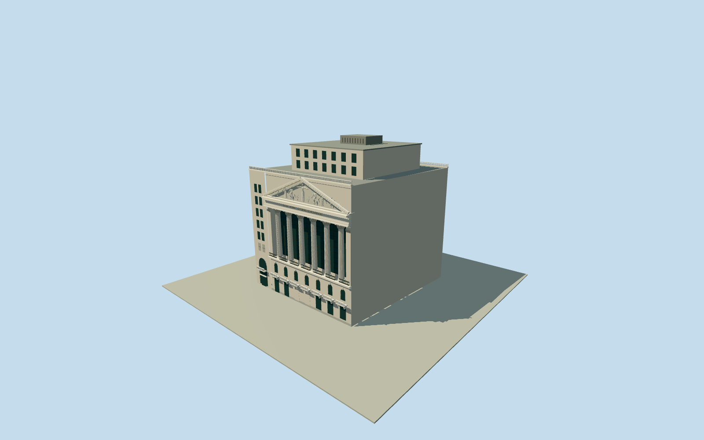

# New York Stock Exchange

1903Broad Street block only: native exterior edges with explicit inferred north interface, six tall fluted Corinthian front columns and six smooth rear columns, bronze-grid recessed glass, seven podium arches/balconies, asymmetric south entrance, triangular pediment with11posed figures and permanent inscription, parapets and conservative upper office/plant roof envelope. Neighboring Wall Street office tower,20Broad,temporary flags/banners,street scenery and trading-floor interiors excluded.

Authoring state: **medium-fi-exterior-source-preview-reviewed-in-qa**. Current completion evidence is in [qa.json](qa.json) and the [local 100 ledger](../../../../qualla-structures/batches/PROGRESS.md).

- [New York Stock Exchange](https://qualla.com/new-york-stock-exchange/)

Photographic medium-fi1903exterior with bounded independent source-ground preview, not surveyed facade/foundation or navigable trading floor.

Nativeparentcombines18Broad/11Wall; ownnorthinterface joins retained parentvertices by explicit scope inference. Quantized map and historical architectural dimensions do not establish cadastral accuracy.

Exact capital leaves,figurative relief,upper roofsetbacks/currentplant and unseen side/back details are estimates. Original47.55mheight controls upper envelope; omit taller11Walloffice tower.

Source-specific USGS NY_CMPG_2013ground unchanged;1msampling does not establish surveyaccuracy or defaultEarthterraincompatibility.

Original photo pixels are not model textures. Ordinary catalog shared graphs, opaque exterior glass, no full-site terrain pad/cutout/generic parent-footprint replacement.

Build: `node packages/worldgen/scripts/generate-authored-places.mjs --ids=new_york_stock_exchange`. Add `--check` to verify exact regeneration. 57027 triangles; 6 materials; no embedded photographs.
