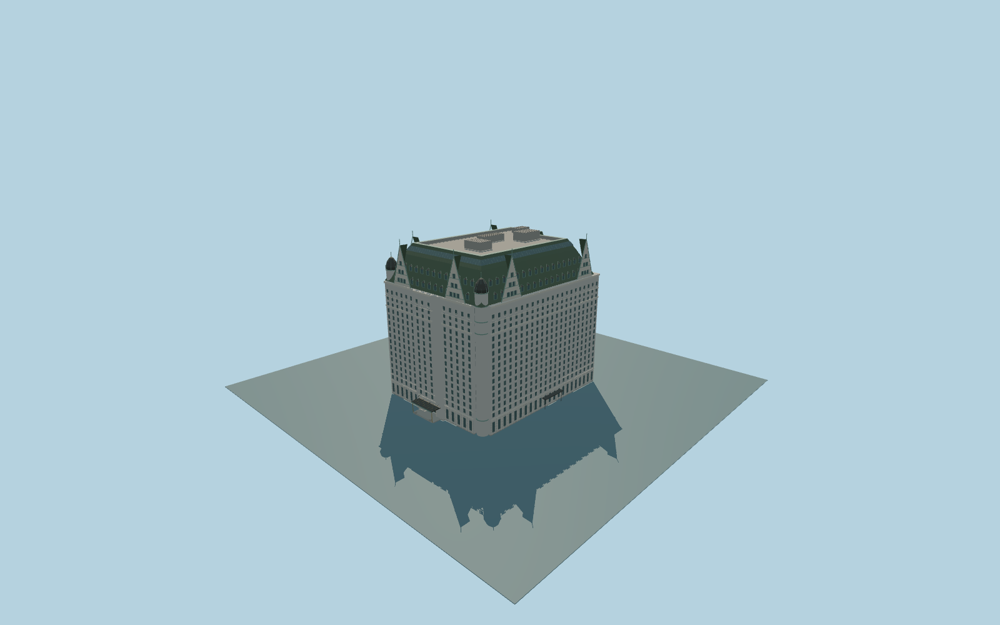

# Plaza Hotel

Complete New York Plaza Hotel:stepped pale masonry hotel with punched windows/rusticated base,green mansard and dormer rows,paired pointed gables,rounded corner bays with ribbed domed caps,ornate cornices/balconies,roofwell/plant and signed Fifth Avenue and park-side canopies.

Original source:models/plaza-model.mjs,layout.json and attributed map/global-terrain controls. Rebuild with `node packages/worldgen/scripts/generate-plaza-hotel.mjs`;append `--check` for exact bytes. Import/LOD commands select `--ids=plaza_hotel`. GLBs are ignored outputs.

Five existing shared256px graphs;no private or embedded images. Detailed master and four browser tiers are separate. Main entry faces+X/ESE toward Fifth Avenue/Grand Army Plaza;long facade-Z/NNE toward Central Park South. Exact stepped outline controls the ground mass.76m retained height guides the reconstruction;85m mapped height differs and remains documented. Gables,turrets,dormers,facade inventories and site grades are approximate. Adjacent spired church is excluded. See model-brief.json and qa.json for scope/current acceptance.

Original geometry uses the repository license. Maps:© OpenStreetMap contributors,ODbL-1.0;Protomaps. Global terrain hashes/attribution:terrain-grid.json. Linked ordinary pictures are not redistributed or used as textures.
