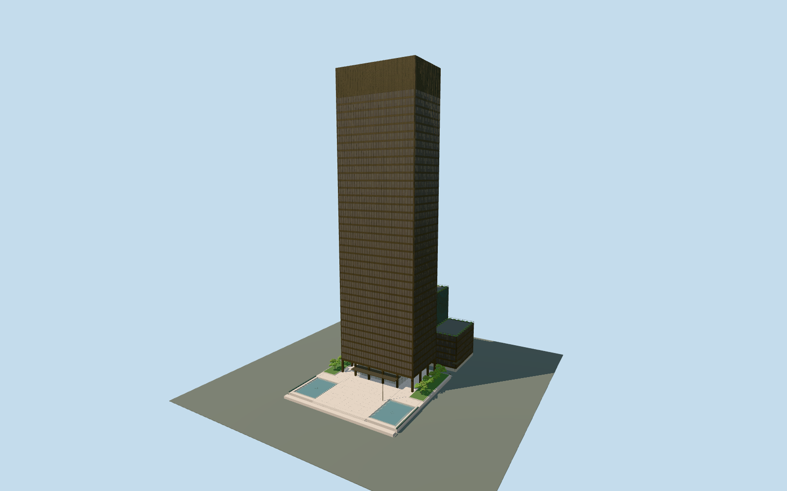

# Seagram Building

Mies and Johnson's bronze-and-glass five-by-three-bay tower, true I-section mullions, controlled Venetian blinds, dark mechanical crown, recessed open colonnade and Muntz marquee, plus the rear spine, unequal-height wings and pink-granite Park Avenue plaza with paired reflecting pools.

## Evidence and reconstruction

Published dimensions and reconstructed details are separated in spec.json. Primary references:

- [Reference](https://s-media.nyc.gov/agencies/lpc/lp/1664.pdf)
- [Reference](https://www.moma.org/documents/moma_catalogue_3349_300190165.pdf)
- [Reference](https://www.skyscrapercenter.com/building/seagrambuilding/3529)
- [Reference](https://www.rfr.com/new-york/seagram-building)
- [Reference](https://seagram375park.com/the-building/specifications/)
- [Reference](https://seagram375park.com/the-building/building-stack-plan/)
- [Reference](https://www.openstreetmap.org/way/145341258)
- [Reference](https://www.openstreetmap.org/way/145341297)

No third-party geometry, photograph or bitmap texture is embedded. Shared surface graphs come from the central library; vertex tints carry model colors. Glazing uses PBR materials; transparent surfaces are declared per model.

## Model and axes

286,644 triangles; 744,156 vertices; 10 material groups; 30,234,772 bytes. Native bounds: -31.350, 0.000, -48.364 to 31.350, 157.015, 46.800. Source hash: `sha256:708547d760a77815f7e2aa590550e632f6c64411f5f64eed88aedb66d361b819`.

{"up":"+Y","longAxis":"+X toward52nd Street SSW","front":"+Z toward Park Avenue WNW"}

Main slab center and signed facade frame are registered independently of the attached rear projection. Park Avenue plaza faces+Z/WNW,52nd Street lies+X/SSW and the low wings/bustle extend east to−Z. The exact parent footprint and named shaft parts agree with LPC/MoMA plans. Lowest local curbY0; raised granite plaza and reconstructed street fall are included. Existing source-local map-frame.json is retained byte-for-byte. Native+Z follows Park Avenue WNW and+X52nd Street SSW; the rear extra bay/bustle resolves the frame rotation. Plaza and street fall are architectural reconstructions rather than surveyed terrain; flat procedural Earth context does not verify native grades.

## Reproduce

Run `node packages/worldgen/scripts/generate-signature-towers.mjs --ids=seagram_building` (or add `--check`). The generator preserves manually edited masters by checking their baseline hashes. Import through the standard authored-model workflow with optimization disabled; then capture all QA cameras, including shared-surface views.

## Pending work

- Exterior geometry uses published overall dimensions and map evidence; panel subdivision, connection dimensions and local entrance details are reconstructed. Glazing uses opaque PBR with explicit geometry; no copied facade photograph is embedded.
- Curtain-wall modules and I sections follow measured published dimensions; internal floor heights, the mechanical crown split, individual blind settings, bronze patina, terrace planting and curb-grade reconstruction follow public images. Permanent pool hardware is modeled without frozen water jets. Temporary public sculpture, flags, tenant lettering, interiors and subterranean parking are excluded.
- Detailed286644-triangle source master remains byte-identical, including original I-section extrusions,45-degree blind slats, fountain hardware, planting and lobby detail. Separate browser levels retain the distinctive slab, rear extra bay, unequal wings/bustle, mechanical crown, open columns/recessed opaque lobby, canopy, raised plaza and paired depressed pools. Skyline aggregates facade glazing/crown and omits trees, fine rails, pool rims and door cases. District restores sparse bronze mullions/floor bands and faceted trees. Street restores all37 main office bands, intermediate mullions, pool rims, steps, door cases, terrace railings and roof planting. Close-up restores original114.3×152.4mm bronze I-section dimensions and three-stop blind patterns as pane faces; individual blind slats and translucent layered interiors remain in the source master. Bronze and granite use shared graphs; foliage and opaque glass use local PBR colors without bitmap copies. Shared granite approximates the small travertine/marble surfaces and roof; tree shapes, bronze patina, applied blinds and revolving-door cases remain exterior approximations. Source-local map frame, surveyed module dimensions and architecture-relative grades are retained; exact native terrain/curb fit and physical laptop/phone timing remain unmeasured. Error values8/4/2/1m are authoring estimates, not certified whole-mesh errors.

This bundle follows the medium-fi standard. Medium-fi appearance and geographic fit are reviewed separately. Hash-bound visual acceptance is recorded separately after capture inspection.
