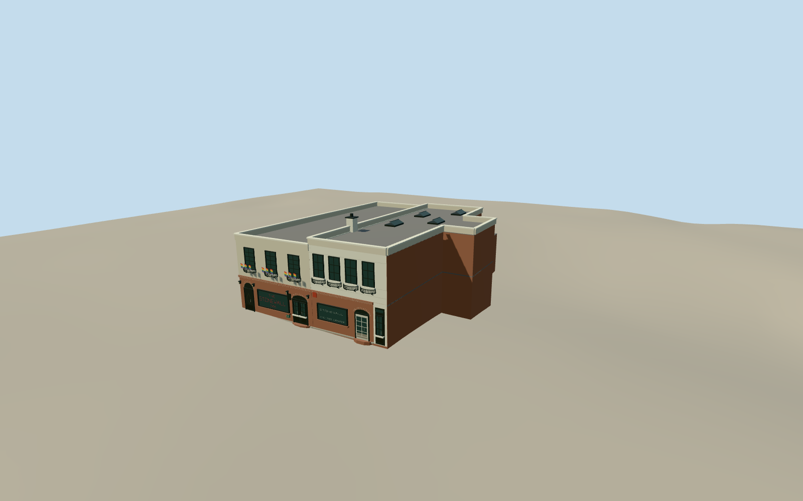

# Stonewall Inn

Both former stable buildings at 51–53 Christopher Street: brick storefront arches, contrasting stucco upper facades, three/four casement bays, curved iron baskets, stepped parapets and current visitor-center entrance.

Authoring state: **review-in-qa.json**. Current completion evidence is in [qa.json](qa.json) and the [local 100 ledger](../../../../qualla-structures/batches/PROGRESS.md).

- [The Stonewall Inn: From Horse Stables to Hallowed Ground](https://qualla.com/stonewall-inn/)

Original medium-fi exterior of 51–53 Christopher Street, using individually inspected local 2014/2016 photos, official city designation photo/map and current NPS visitor-center photograph. No exact 1969 reconstruction.

Both individual mapped footprints are retained; taller neighboring buildings, interiors, crowds and temporary banners are excluded.

Vertical dimensions and hidden rear/roof details are approximations. The 51 rear-wing upper-story termination, skylight spacing and equipment positions are interpreted from limited evidence.

Small pride flags, window baskets, lanterns and storefront lettering are simplified original geometry. The red sign is colored geometry, not a physically simulated neon tube. No photo pixels or official visitor-center logos are embedded.

Map heights are coarse controls, with parapets interpreted from facade photographs. Independent terrain is unchanged; exact contact can differ with another host DEM.

Build: `node packages/worldgen/scripts/generate-authored-places.mjs --ids=stonewall_inn`. Add `--check` to verify exact regeneration. 7733 triangles; 7 materials; no embedded photographs.
