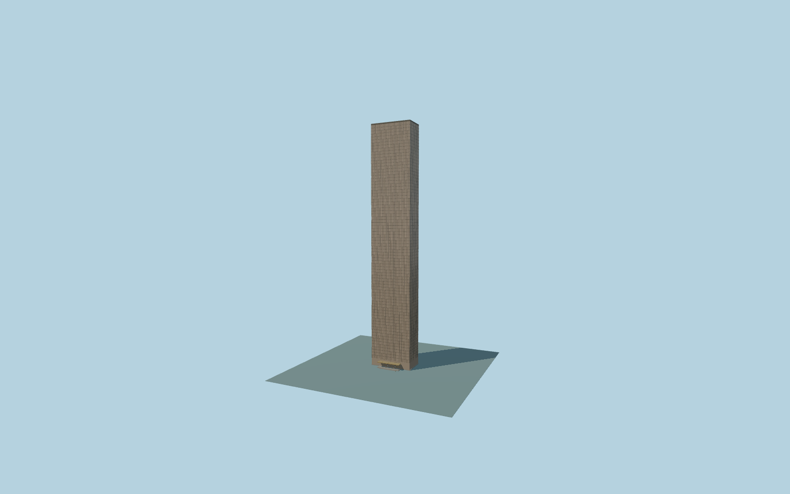

# Trump World Tower

Complete262m bronze-glass rectangular residential tower at845 United Nations Plaza,with fine regular curtain-wall grid,flat parapet/crown,east-southeast gold entrance canopy,coffered soffit,revolving doors,address/sign and native-fitting entrance stairs.

Original source:models/trump-model.mjs,layout.json and attributed map/global-terrain controls. Rebuild with `node packages/worldgen/scripts/generate-trump-world-tower.mjs`;append `--check` for exact bytes. Import/LOD commands select `--ids=trump_world_tower`. GLBs are ignored outputs.

Four existing shared256px material graphs;no private or embedded images. Detailed master and four browser tiers are separate. This is845 United Nations Plaza,not Fifth Avenue Trump Tower. The gold canopy faces+Z/ESE toward United Nations Plaza. Near tiers retain real entry apertures,two revolving-door rotors,coffered canopy,sign and approximate native-fitting stairs. Source master adds pane recess returns and finer roof/entry detail. Ground datum10m and original façade/entry sections remain approximate. See model-brief.json andqa.json for scope/current acceptance.

Original geometry uses the repository license. Maps:© OpenStreetMap contributors,ODbL-1.0;Protomaps. Raw global terrain hashes/attribution:terrain-grid.json. Linked ordinary pictures are not redistributed or used as textures.
