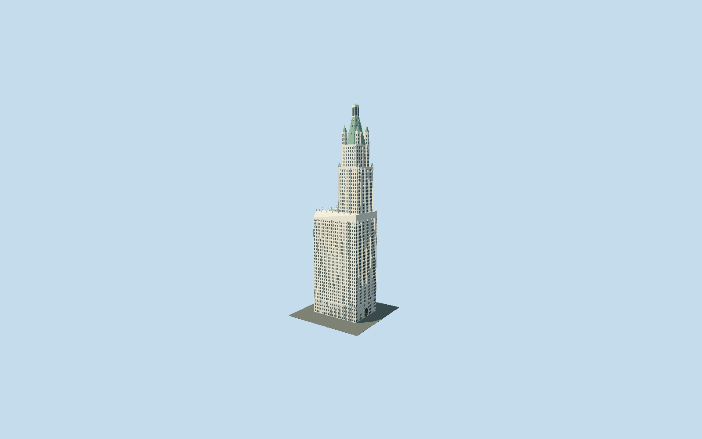

# Woolworth Building

Complete Woolworth exterior: U-shaped western court, cream Gothic tower and tourelles, compound green copper crown and recessed Broadway Tudor portal.

## Evidence and reconstruction

Published dimensions and reconstructed details are separated in spec.json. Primary references:

- [Reference](https://nylandmarks.org/explore-ny/the-woolworth-building/)
- [Reference](https://www.nypl.org/blog/2013/04/22/woolworth-building-cathedral-commerce)
- [Reference](https://s-media.nyc.gov/agencies/lpc/lp/1273.pdf)
- [Reference](https://www.nicholsonandgalloway.com/news/nicholson-and-galloway-awarded-woolworth/)
- [Reference](https://www.openstreetmap.org/way/75363809)

No third-party geometry, photograph or bitmap texture is embedded. Shared surface graphs come from the central library; vertex tints carry model colors. Glazing uses PBR materials; transparent surfaces are declared per model.

## Model and axes

122,851 triangles; 286,299 vertices; 7 material groups; 11,785,112 bytes. Native bounds: -29.441, 0.000, -22.413 to 29.803, 241.402, 22.820. Source hash: `sha256:77bf8822184dc51134b52d99db03a748be8fd06e79ffc2efaa42caedd508cae9`.

{"up":"+Y","longitudinal":"+X toward Broadway southeast","front":"+X Broadway portal","origin":"Ground contact in exact-Q217652 mapped parcel frame"}

The geographic proposal uses exact-QID OpenStreetMap evidence. Map-derived orientation and estimated architectural details require real-site visual review; preview eligibility is distinct from geographic/fidelity approval. Map attribution: © OpenStreetMap contributors, ODbL-1.0.

## Reproduce

Run `node packages/worldgen/scripts/generate-signature-towers.mjs --ids=woolworth_building` (or add `--check`). The generator preserves manually edited masters by checking their baseline hashes. Import through the standard authored-model workflow with optimization disabled; then capture all QA cameras, including shared-surface views.

## Pending work

- Whole medium-fi Woolworth parcel retains the U-shaped base, open western light court, Broadway tower, two setbacks, eight mapped corner tourelles and241.4016m published792ft height. Original137916-triangle master recipe is preserved unchanged and reproducible. Reviewed source corrects the false sharp entrance to a genuinely recessed depressed Tudor arch with three-bay transom, center revolving enclosure, side doors and balcony. Compound crown now has large green copper pyramid, dormers, octagonal window lantern, smaller pyramid and finial; lower western wings have shallow copper mansard/dormer ribbons. These shapes follow inspected primary city/owner/restoration images; individual roof and doorway dimensions are reconstructed, not a surveyed plan. The published1983 designation describes historic tourelles and730ft gallery; current owner and2019 restoration photographs distinguish the recognizable compound roof from restoration details. Roof subdivisions194/224/236.2/237.8m are fitted within the published total using the mapped envelope. Seven-foot2.1336m granite water table and lower four-story limestone have separate shared bindings; glazed cream terra cotta uses generic shared ceramic coating with blue accents, copper and bronze use existing shared graphs. No embedded or copied reference images. Continuous piers, pointed upper windows, sill courses and finials are explicit source geometry; street drops tiny frames, district merges window bands, skyline keeps all principal masses and the crown lantern. Sculptural faces, heraldic carving, exact polychrome motifs, interior, current hardware, lower chateau roof layouts and temporary barriers are simplified or omitted. Lower roof ribbons and dormer counts are illustrative. Opaque glass and graphic window overlays are medium-fi abstractions; only the Broadway portal is cut through the facade layers. Ground grade, night, physical-device timing and full-scene memory remain unmeasured.

This bundle follows the medium-fi standard. Medium-fi appearance and geographic fit are reviewed separately. Hash-bound visual acceptance is recorded separately after capture inspection.
