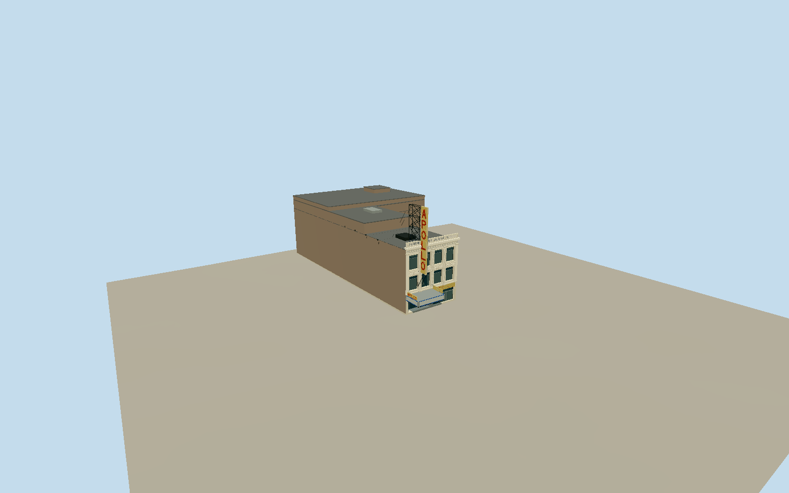

# Apollo Theater

Dated2013–2019 Harlem Apollo: four-bay glazed white terracotta front/five colossal pilasters, two square/transomed window tiers and fluted shield/meander spandrels, deep modillion cornice/open baluster parapet. Recessed western entrance/four doors under half-width projecting marquee with blue bands, pale display panels, warm soffit bulbs and two short-side APOLLO caps. Eastern glazed shop/yellow APOLLO fascia belongs to same frontage. Two-sided pale-yellow APOLLO blade with original geometric red letters/counters/neon strokes, open three-tier black steel trestle/V bracket. Exact native L-shaped stepped auditorium roof envelope; neighboring buildings/new Victoria spaces excluded.

Authoring state: **review-in-qa.json**. Current completion evidence is in [qa.json](qa.json) and the [local 100 ledger](../../../../qualla-structures/batches/PROGRESS.md).

- [Apollo Theater: Where Harlem Made America Listen](https://qualla.com/apollo-theater/)

Dated2013–2019 facade/marquee/blade, with2007/2010sign details. Owner confirms ongoing2025–2027restoration and2026relighting; future lobby/sign updates are not claimed as surveyed current appearance.

Native L-shaped historic envelope retained. Database20mheight is an approximate rear mass control; front cornice/parapet, roof steps, sign height, recesses and fine relief are photo-proportioned, not measured drawings.

2024LPCpresentation PDF was discovered but web read was too large and direct request403; not inspected or used.1983exterior description and local originals/aerial provide the actual inputs.

No auditorium interior/pews/stage, adjacent newer Victoria spaces, Banana Republic/GameStop/Cinderella stores, street furniture/crowds/vehicles, event advertising, original pavement art or photo pixels. Independent original terrain remains unchanged.

Cornice/parapet17.38m, blade25.2m and rear roof20m are photo/aerial-proportioned estimates, not measured elevation drawings. Shared concrete graph approximates glazed terracotta; original opaque palette glazing/sign colors and geometric typography; event content omitted. Fine shield/anthemion/neon profiles, hidden roof equipment/side/rear walls and exact marquee curves are simplified.

Build: `node packages/worldgen/scripts/generate-authored-places.mjs --ids=apollo_theater`. Add `--check` to verify exact regeneration. 15818 triangles; 6 materials; no embedded photographs.
