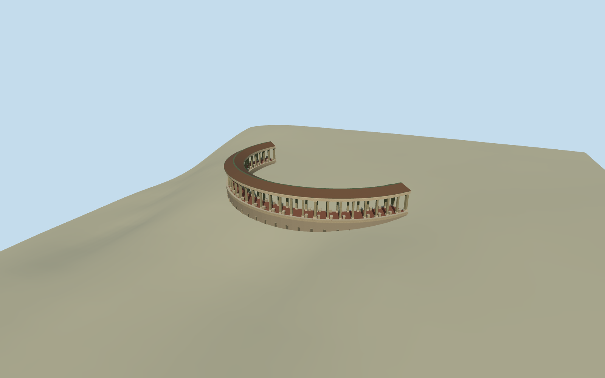

# Hall of Fame for Great Americans

Stanford White’s curved limestone colonnade with its tile roof, granite podium and open gallery in the Bronx.

Authoring state: **review-in-qa.json**. Current completion evidence is in [qa.json](qa.json) and the [completion ledger](../../../../qualla-structures/batches/qualla-004.PROGRESS.md).

- [Hall of Fame for Great Americans](https://qualla.com/hall-of-fame-for-great-americans/)

The independently mapped central crescent, its roof and its supporting granite podium. Attached library, wings and adjacent buildings are outside scope.

The original walkway level and exact column and plinth profiles are estimates. Sculpture and inscriptions are outside scope.

Build: `node content/worldgen/source/places/dr/dr7/hall_of_fame_for_great_americans/models/generate-hall-of-fame-for-great-americans.mjs`. Add `--check` to verify exact regeneration. 5514 triangles; 7 materials; no embedded photographs.
