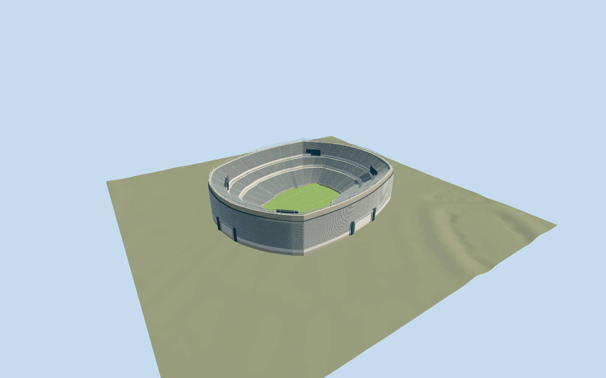
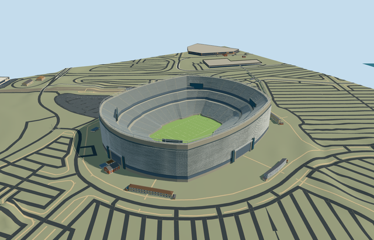

# metlife_stadium — MetLife Stadium

Reviewed 2026-10-20 in one continuous author/build/inspect/fix round.

## Appearance

Inspected all47 current portable/shared/medium-fi/native-map views. Complete native-shaped open stadium: three stepped seating tiers/radial concrete aisles, suite/concourse bands, closed football field/runoff/linework/two goalposts, four supported inward-facing corner boards, horizontal silver louvers/unblocked entrance groups and attached neutral display pylons, glazed lower bands and open lighting rim. Corrected supported field closure, broad entrance clearance and the geometry budgets during construction. Three ordinary2012/2024/2026 exterior/interior pictures guide shape/materials. Rows are grouped, faces remain visibly polygonal and lighting changes across facets. No invented field roof, missing tier, copied screen/text/team atlas, crowd, service interior or neighboring complex platform.

## Shared materials and browser levels

Four existing256-square concrete_plain/metal_painted/window_grid/fabric_canvas graphs; all canonical refs, zero embedded images or unique texture atlas. Common canvas grain is tinted green as a low-frequency synthetic-turf approximation, not a literal grass-blade surface. Concrete, silver slats, gray seating, neutral screen panels/goalposts and glass use shared graphs with semantic tints. Actual shared loader reads each graph once and releases all model geometry on unload. At most four near-level draws/one skyline draw, separate POSITION/NORMAL GPU streams and equal CPU/GPU geometry byte accounting.

| Level | Triangles | Bytes | Draws |
| --- | ---: | ---: | ---: |
| skyline | 756 | 73940 | 1 |
| district | 3290 | 287684 | 4 |
| street | 15722 | 1329232 | 4 |
| closeup | 55482 | 4689624 | 4 |

Levels756/3290/15722/55482triangles; bytes73940/287684/1329232/4689624. Initial skyline+district361624bytes, below3MB phone/6MB laptop targets. Detailed source master55482triangles/6660796bytes retained; closeup4689624bytes is requested only near the stadium. Four independently authored levels retain the open three-tier bowl, footprint and corner boards; distant levels group rows/louvers and omit small posts/markings, with street budget met by15 row groups/10 louver bands. Closeup has60 row groups/28 louver bands. All four ceilings1000/4000/16000/64000 pass. Economy/high noon/late-afternoon, silhouettes/transitions and detail frames inspected. Physical devices and dense-city performance remain pending. Levels756/3290/15722/55482 triangles; at most four draws.

## Approximate map fit

Exact retained-QID way24221553 and native parent52776566924878/137 contained grandstand parts identify the stadium. Own anchor-74.074346839,40.813524037, global heading0/native east-south; internal X[.210397710,.977615877]/Z[-.977615877,.210397710] retains the long football-field direction. The retained282.174x229.412m outer outline and parent field hole control shell/bowl; fine portal/screen/aisle allocation retains20degree/2m uncertainty. Floor1.318261m/bounded shell feet/internal field volume cross original6m DEM without outside-complex slab, terrain flattening or cutouts. Only parent/137 owned parts removed, zero residual;35 independent resident inputs among173 originals (183 wider records), native roads/parking context and166830.4590289733m2 water remain unchanged. Failure restores173 originals; each level unloads with zero live model geometry.

## Limits

Accepted medium-fi visualization of the complete stadium envelope and visible bowl. No qualified height is retained. Field.3m/lower tier2..19m/middle24..33m/upper38..54m/shell47.5m/open rim58.5m, row/section counts, screens/entry/rim inventory and fine elevations are picture-led estimates. Football rectangle109.728x48.768m is a neutral representative configuration, not an event-specific survey. Seats use merged stepped bands rather than individual chairs; changing team/sponsor lettering/live screens, crowds, service rooms, temporary FIFA/soccer/concert fixtures, adjacent venues and parking are outside the asset scope. Terrain/field datum/roofless stadium drainage are approximate, not surveyed foundation/flood or as-built measurements.

## Selected checks

Six Khronos files: zero errors/warnings.366 actual mesh/material/contact checks; 47 current inspected views. Scene validation/sim30 and strict selected medium-fi audit pass. Source/runtime/LOD hashes and material bindings verified.

Rebuild: node packages/worldgen/scripts/generate-additional-landmarks.mjs --ids=metlife_stadium; node packages/worldgen/scripts/import-structure-models.mjs --ids=metlife_stadium; node packages/tooling/scripts/generate-landmark-lods.mjs --ids=metlife_stadium --force.

Source: sha256:b87eef2100088d6360b324d3268f87558855428b85a86d9007a33ffa871d642a

Runtime: sha256:b3fc84b6b0485e45d12f3a20f52e38463456e4181c27a02cd1d40d12e15a577e

Input: sha256:efe0df6febfe8080bfb7893be6feaa19723e47df1faff3b0702953f569a23786

## Viewed ordinary pictures

https://commons.wikimedia.org/wiki/File:MetLife_Stadium_Exterior.jpg — gargudojr; CC-BY-SA-2.0. Viewed only; no pixels copied.

https://commons.wikimedia.org/wiki/File:Interior_view_of_the_MetLife_Stadium_-_ARG_v_CAN_-_2024-07-09.jpg — Sebas; CC-BY-3.0. Viewed only; no pixels copied.

https://commons.wikimedia.org/wiki/File:MetLife_Stadium_Exterior,_2026_FIFA_World_Cup_(June_20,_2026)_(cropped).jpg — MiracleMiles; CC-BY-4.0. Viewed only; no pixels copied.
