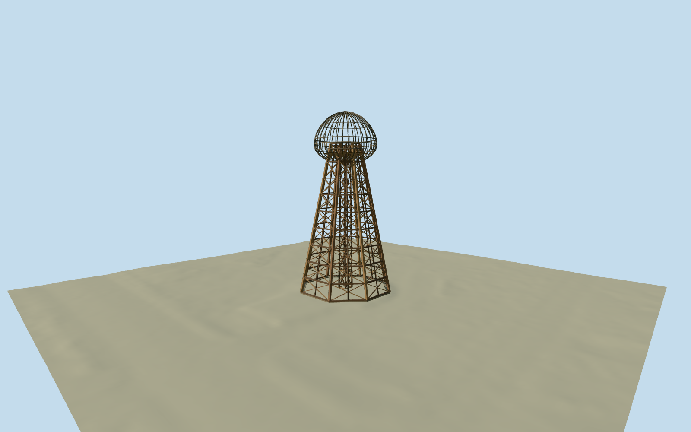

# Wardenclyffe Tower

The exposed octagonal timber frame and unfinished ribbed crown of Wardenclyffe Tower as published in 1904.

Authoring state: **review-in-qa.json**. Current completion evidence is in [qa.json](qa.json) and the [completion ledger](../../../../qualla-structures/batches/qualla-004.PROGRESS.md).

- [Wardenclyffe Tower](https://qualla.com/wardenclyffe-tower/)

Shows the 1904 archival appearance and remains hidden in the modern view. Subsurface works, the contiguous industrial grounds and the adjacent lab are outside the model.

The historic open timber frame and cupola use the documented dimensions. Individual interior braces, fasteners and timbers omitted behind the published view are representative.

The current independent survey supplies geographic terrain. Fine grade around the tower in 1904 is estimated.

Build: `node content/worldgen/source/places/dr/drk/wardenclyffe_tower/models/generate-wardenclyffe-tower.mjs`. Add `--check` to verify exact regeneration. 12886 triangles; 4 materials; no embedded photographs.
