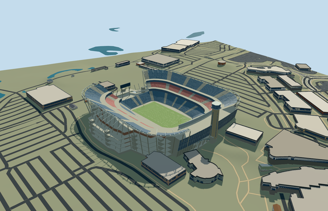

# N0725 — Gillette Stadium

Reviewed 2026-10-20 in one continuous author/build/inspect/fix round.

## Appearance

Inspected48 current views across the source turntable/details, shared-material placement, noon/late economy/high and all four levels, native site and failed-load fallback. Specific renovated2023 north end: complete new octagonal lighthouse with tall corner glazing/observation ring/lantern/flat crown; large curved neutral north display and leaning-glass G-P Atrium; blue arched entry deck/piers/guards and a real open underpass; open blue lower/upper and red middle side banks, two closed hospitality belts, pale aisles, lower end banks, side lighting girders, native-shaped brick/concrete services and cores. Upper stands use a smooth picture-led envelope while retaining the original lower concourse outline. Corrected an obscured arch, serrated upper rows, a rear wall blocking the entry and the simplified skyline gate in this same pass. Portable and native views show the whole lighthouse crown; two tight shared/synthetic detail cameras crop its upper edge and are used only for lower facade/entry checks.

## Shared materials and browser levels

Five existing256px shared material graphs: concrete_plain, brick, metal_painted, fabric_canvas and window_grid. No embedded images or unique texture atlas. Actual shared runtime binds each graph once; near geometry uses five draws, skyline merges into one draw. Separate position/normal streams avoid duplicated GPU uploads; CPU/GPU byte accounting agrees. Opaque shared glazing and muted blue/red seats keep the medium-fi palette.

| Level | Triangles | Bytes | Draws |
| --- | ---: | ---: | ---: |
| skyline | 872 | 77588 | 1 |
| district | 3974 | 359340 | 5 |
| street | 14174 | 1242084 | 5 |
| closeup | 62272 | 5587384 | 5 |

Skyline/district/street/closeup preserve the open bowl, field, curved north board, atrium, new lighthouse and supported entry arch. Repeated rows, trusses, mullions and goals simplify with distance; skyline omits hidden undersides. Initial skyline plus district is436928 bytes, below the3MB phone and6MB laptop targets. These are asset budgets and automated browser renders; physical laptop/phone/tablet and dense-city measurements remain pending. Levels872/3974/14174/62272 triangles; at most five draws.

## Approximate map fit

Own native pitch35184501265667 and named stadiumPOI52776576644818 control the independent stadium parent52776576644817 and new lighthouse35185796940468. Anchor[-71.26435581388355,42.09092707489616], heading0/native east-south/internal north is negativeX. Original6m Mapzen datum79.1632391714457m and all samples are retained. Bounded occupied floor replaces only internal coarse terrain; all38 resident independent buildings, native roads and55825.20974881254m2 water remain unchanged;91 wider independent building inputs are retained unchanged by the actual helper. The99.5percent whole-feature coverage mode removes the own parents without trimming the slightly overlapping Pavilion. Actual PMTiles13/14 generalized merged-campus features fall back to area clipping;15 removes only the owned parents. All four levels load/place/unload; failed load retains40 originals and original ground. Every unload restores ground/water and reports zero live model geometries. Fine positioning/contact and hidden component layout remain approximate.

## Limits

Three actually viewed ordinary exterior/bowl pictures from the architect gallery plus one supplemental atrium interior guided this specific model. No pixels copied. The2018/01 image URL is not an exposure date: the displayed bowl photo visibly has the new lighthouse and large curved board. Neutral American-football marks replace event-specific soccer marks. Operator370ftx60ft board dimensions are a nominal112.776x18.288m visible curved chord approximation. Architect218ft observation-deck wording versus operator218ft tower wording leaves the vertical datum uncertain; deck66.4464m above sampled tower foot and estimated lantern/crown are explicitly approximate. Upper profile, tier heights/row inventory, bridge span, cores, lighting and fine20degree/2m facing are picture-led estimates. Hidden furnished G-P Atrium/Hall of Fame/retail rooms, signs/advertising/crowds and site-wide retail-plaza slabs are excluded. This is medium-fi visualization, not engineering or current-condition certification.

## Selected checks

Six Khronos files: zero errors/warnings.6197 actual mesh/material/contact checks; 48 current inspected views. Scene validation/sim30 and strict selected medium-fi audit pass. Source/runtime/LOD hashes and material bindings verified.

Rebuild: node packages/worldgen/scripts/generate-additional-landmarks.mjs --ids=N0725; node packages/worldgen/scripts/import-next-1000-models.mjs --ids=N0725; node packages/tooling/scripts/generate-landmark-lods.mjs --ids=N0725 --force.

Source: sha256:18a0e0e2c52f2feed2c41147be22706edecb4dbb1f7813306007f84948f04770

Runtime: sha256:724035782540009c9153f326cd2958320f5085b1e91a7669cf5a423b2c6409da

Input: sha256:168f7f6efe93dc4344de907d54f07d85f06e0a4d02de73f5022cf6a78e75f614

## Viewed ordinary pictures

https://populous.com/showcases/gillette-stadium-north-end-zone-expansion-and-renovation — https://populous.com/uploads/2024/02/Gillette_Stadium_North_Endzone_Populous_header-1920x0-c-default.webp; Populous project gallery; individual photographer unspecified; Copyright retained/viewed only/no photo pixels copied. Viewed only; no pixels copied.

https://populous.com/showcases/gillette-stadium-north-end-zone-expansion-and-renovation — https://populous.com/uploads/2024/01/FoxboroMA_STAD_003_TomHarris_medium2-1200x900-c-center.jpg; Tom Harris per image filename in Populous gallery; Copyright retained/viewed only/no photo pixels copied. Viewed only; no pixels copied.

https://populous.com/showcases/gillette-stadium-north-end-zone-expansion-and-renovation — https://populous.com/uploads/2018/01/Gillette_Stadium_Populous-1200x675-c-center.jpg; Populous project gallery; individual photographer unspecified; Copyright retained/viewed only/no photo pixels copied. Viewed only; no pixels copied.

https://populous.com/showcases/gillette-stadium-north-end-zone-expansion-and-renovation — https://populous.com/uploads/2024/01/FoxboroMA_STAD_030_TomHarris-1200x675-c-center.jpg; Tom Harris per image filename in Populous gallery; Copyright retained/viewed only/no photo pixels copied. Viewed only; no pixels copied.
