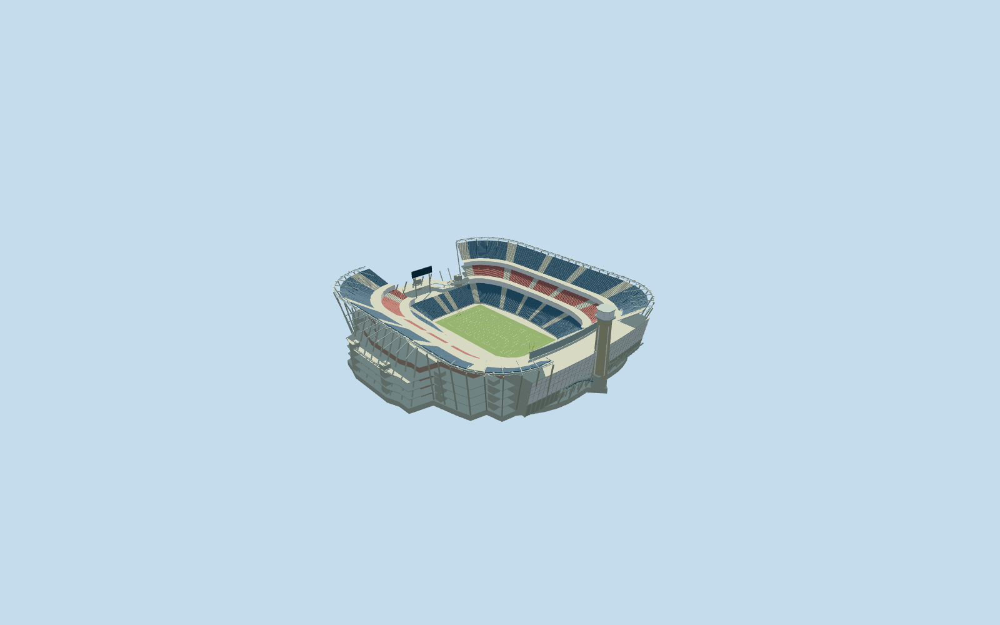

# Gillette Stadium

Specific renovated2023-reference Gillette Stadium: own mapped open stadium/field axis, blue lower and upper side banks/red club bank/two closed hospitality belts/pale aisles/lower end banks/open central north entry/upper side lighting girders, concrete-brick recessed services/galleries/cores, curved neutral370ftx60ft north display/connected leaning-glass G-P Atrium/floors/roof, own new octagonal lighthouse/tall corner glazing/observation ring/lantern/flat crown, supported blue arched entry deck/piers/guards on its east side, south display and neutral American-football field/goals. Five existing shared graphs, no obsolete short lighthouse/copied event screens/logos/furnished hidden rooms/blanket retail-plaza slab. Far levels merge repeated rows/girders while preserving the open-bowl and new north-end silhouettes.

## Evidence and reconstruction

Published dimensions and reconstructed details are separated in spec.json. Primary references:

- [Reference](https://populous.com/showcases/gillette-stadium-north-end-zone-expansion-and-renovation)

Specific renovated2023-reference Gillette Stadium: own mapped open stadium/field axis, blue lower and upper side banks/red club bank/two closed hospitality belts/pale aisles/lower end banks/open central north entry/upper side lighting girders, concrete-brick recessed services/galleries/cores, curved neutral370ftx60ft north display/connected leaning-glass G-P Atrium/floors/roof, own new octagonal lighthouse/tall corner glazing/observation ring/lantern/flat crown, supported blue arched entry deck/piers/guards on its east side, south display and neutral American-football field/goals. Five existing shared graphs, no obsolete short lighthouse/copied event screens/logos/furnished hidden rooms/blanket retail-plaza slab. Far levels merge repeated rows/girders while preserving the open-bowl and new north-end silhouettes.

## Model and axes

62,272 triangles; 186,816 vertices; 5 material groups; 7,476,040 bytes. Native bounds: -138.419, -4.962, -153.631 to 148.507, 74.792, 151.529. Source hash: `sha256:18a0e0e2c52f2feed2c41147be22706edecb4dbb1f7813306007f84948f04770`.

{"x":"east","y":"up","z":"south"}

The geographic proposal uses exact-QID OpenStreetMap evidence. Map-derived orientation and estimated architectural details require real-site visual review; preview eligibility is distinct from geographic/fidelity approval. Map attribution: © OpenStreetMap contributors, ODbL-1.0.

## Reproduce

Run `node packages/worldgen/scripts/generate-additional-landmarks.mjs --ids=N0725` (or add `--check`). The generator preserves manually edited masters by checking their baseline hashes. Import through the standard authored-model workflow with optimization disabled; then capture all QA cameras, including shared-surface views.

## Pending work

- Specific renovated2023-reference Gillette Stadium: own mapped open stadium/field axis, blue lower and upper side banks/red club bank/two closed hospitality belts/pale aisles/lower end banks/open central north entry/upper side lighting girders, concrete-brick recessed services/galleries/cores, curved neutral370ftx60ft north display/connected leaning-glass G-P Atrium/floors/roof, own new octagonal lighthouse/tall corner glazing/observation ring/lantern/flat crown, supported blue arched entry deck/piers/guards on its east side, south display and neutral American-football field/goals. Five existing shared graphs, no obsolete short lighthouse/copied event screens/logos/furnished hidden rooms/blanket retail-plaza slab. Far levels merge repeated rows/girders while preserving the open-bowl and new north-end silhouettes.
- RetainedQ373355/named native stadium POI52776576644818 and native field35184501265667 identify own stadium parent52776576644817. Separate octagonal lighthouse35185796940468 supplies direct base/position control, not generic old-lighthouse placement. No exact-QID field in extract. Main parent merges two tile fragments into109-point outer/26-point hole, approximately316x277m body. Separate120.77045302574675x71.61555047357405m mapped field surround supplies own axis. Anchor[-71.26435581388355,42.09092707489616]/heading0/native east-south/internal X[0.3023465313905019,0.9531980775033762]/Z[-0.9531980775033762,0.3023465313905019]. North is internal negativeX; lighthouse center[-136.63669278476462,-1.2822482135271036]. Working lower opening clips only the native narrow north access neck atX-66m while leaving a central gate. Complete neutral109.728x48.768m NFL field remains distinct from larger mapped surround. Fine20degree/2m facing/component layout are picture-led estimates.
- No qualified native architectural height. Operator2023 announcement gives new board370ftx60ft (112.776x18.288m nominal span/height), approximated as a curved visible chord. Architect describes observation deck218ft (66.4464m), operator sometimes describes218ft tower overall; working deck66.4464m above original own sampled foot/estimated lantern6.4m and crown7m above deck explicitly do not resolve that datum ambiguity. Working field0/lower1.4..16m/red club22..29m/upper34..48m/belts16..22 and29..34m/side light girders50m/atrium12.5..35.5m/display24..42.288m/bridge deck12.5m/arch springs5.5m and crown11.5m/south screen26..34m are picture-led allocations. Tower shaft taper/window/ring/crown proportions, exact row/portal/lighting inventory/bridge span and fine placements are approximate. Shared brick/concrete/glazing represent medium-fi materials, not exact construction/optics. No hidden furnished G-P Atrium/Hall of Fame/retail rooms. Completed north-end reference era modeled, not inferred from image upload dates or old short-lighthouse plans.
- Original6m Mapzen samples/native roads/water/all independent building inputs remain unchanged. Original datum79.1632391714457m defines occupied common field floor0, with outer original grade-4.46184745246714..15.542366442890057m. Own tower/frames/approach contacts retain sampled grades; basement/retaining feet extend to supported common floor where the bounded opening removes coarse terrain. Opening stays within90percent main body/all-level supported floor; only main stadium and new lighthouse records replaced by99.5percent whole-feature coverage; small source overlaps at Pavilion boundaries do not trim neighboring detailed buildings; generalized lower-zoom merged complexes use area clipping. Hall of Fame/Pavilion/shops/statues/practice fields/retail plaza remain native. Failure/unload retain or restore original context.

This bundle follows the medium-fi standard. Medium-fi appearance and geographic fit are reviewed separately. Hash-bound visual acceptance is recorded separately after capture inspection.
