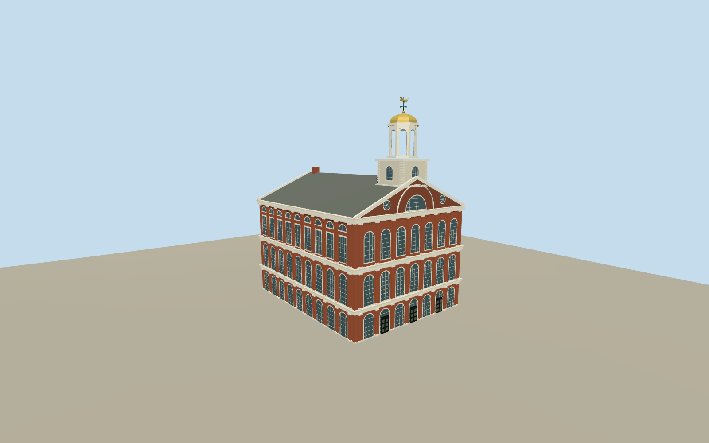

# Faneuil Hall

Three-storey seven-bay brick gables, long arcaded side elevations, white cornices and pilasters, slate gable roof and east-end open cupola with a gilded grasshopper weather vane.

Authoring state: **review-in-qa.json**. Current completion evidence is in [qa.json](qa.json) and the [local 100 ledger](../../../../qualla-structures/batches/PROGRESS.md).

- [Faneuil Hall: The Cradle of Liberty Built on Slavery's Profits](https://qualla.com/faneuil-hall/)

Original medium-fi exterior from inspected local Qualla photographs and generalized hall/cupola footprints; not a measured architectural survey.

Facade bay rhythm, arched fanlights, pilasters, cornices, gables, open lantern and grasshopper silhouette are retained. Fine Corinthian ornament, pane counts, access ramps, plaques and hidden roof service details are simplified.

Only historic Faneuil Hall is included. Quincy Market, neighboring market buildings, plaza furniture and interiors are excluded.

Height estimates and entrance datum are photographic/map interpretations. Other host elevation datasets may require a new placement review.

Reference photography remains in Qualla; no photos are embedded or redistributed in the runtime pack.

Build: `node packages/worldgen/scripts/generate-authored-places.mjs --ids=faneuil_hall`. Add `--check` to verify exact regeneration. 17196 triangles; 5 materials; no embedded photographs.
