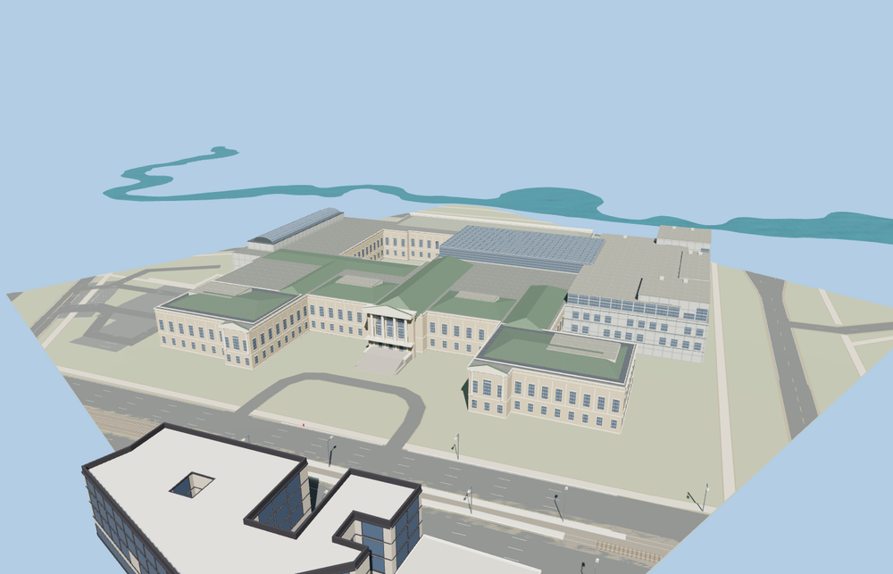

# Museum of Fine Arts Boston

Boston’s Museum of Fine Arts with its twin Huntington Avenue limestone wings and stepped central portico, the long Fenway colonnade, an open west courtyard, and the glazed Art of the Americas addition and Shapiro roof.

The 15,704-triangle source rebuilds byte for byte. Skyline, district, street and close-up use 970, 3,904, 6,964, 14,234 triangles. The first two tiers total 397,412 bytes. Six GLBs validated and 38 current views were inspected.

All four tiers pass sixteen foundation contacts, six probes in the two open courts, five roof probes and both stairs at grade. The viewer preserves the original terrain and the independent buildings and roads. Failed loading retains the native museum shell.

Roof heights and pitches, stair grade and window rhythms are visual approximations from ordinary photos, PMTiles and standard Terrarium. Interior galleries, sculpture and landscaping are outside the authored scope. Physical-device timings are unmeasured.

Rebuild with `node packages/worldgen/scripts/generate-museum-of-fine-arts-boston.mjs`. Append `--check` to compare exact bytes. Use `--ids=museum_of_fine_arts_boston` for targeted import, LOD, placement and readiness.
