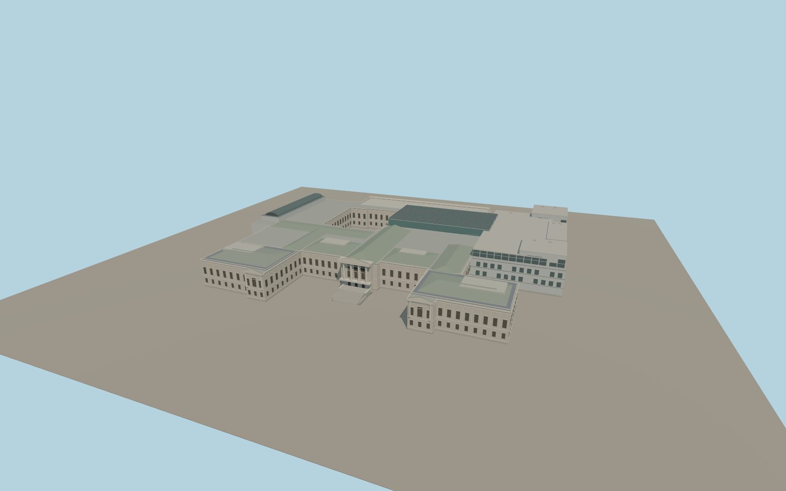

# Museum of Fine Arts Boston

Boston’s Museum of Fine Arts with its twin Huntington Avenue limestone wings and stepped central portico, the long Fenway colonnade, an open west courtyard, and the glazed Art of the Americas addition and Shapiro roof.

Run `node packages/worldgen/scripts/generate-museum-of-fine-arts-boston.mjs` to rebuild the source master. Append `--check` to compare the exact bytes. Use `--ids=museum_of_fine_arts_boston` for targeted import, LOD generation and placement.

Roof heights, pitches, window rhythms and the stair profile are approximated from ordinary photos, the mapped outline and standard Terrarium.

The model covers the connected exterior. Galleries, sculpture and landscaping are outside the scope.

Original geometry:repository license. Map:© OpenStreetMap contributors,ODbL-1.0;Protomaps. Standard terrain:terrain-grid.json. Ordinary pictures stay local and are not redistributed or used as textures. Current acceptance:qa.json.
