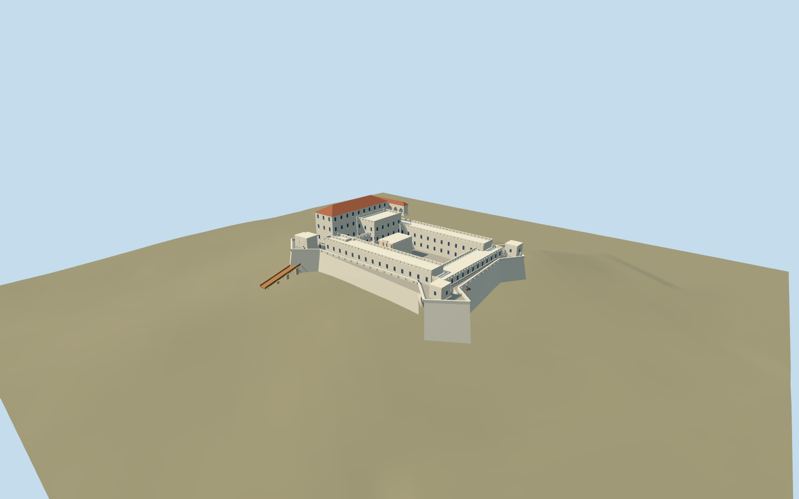

# Elmina Castle

Original approximate exterior with battered white bastioned curtain walls,terraced batteries,open main and smaller courts,stepped governor blocks with a real upper loggia,brick-pilastered former church,and arched gateway approached over timber bridge.

## Evidence and reconstruction

Published dimensions and reconstructed details are separated in spec.json. Primary references:

- [Reference](https://gmmb.gov.gh/st-georges-castle-elmina-castle-elmina-1482/)
- [Reference](https://gmmb.gov.gh/st-georges-castle-elmina-castle-museum-1997/)
- [Reference](https://whc.unesco.org/en/list/34/)
- [Reference](https://gmmb.gov.gh/wp-content/uploads/2020/06/St.-George’s-Castle-Elmina-Castle-Elmina-1482-1.jpg)
- [Reference](https://visitghana.com/wp-content/uploads/2025/04/360-ELMINA-CASTLE-1.jpg)
- [Reference](https://commons.wikimedia.org/wiki/File:Elmina_Castle_Inner_Courtyard_30_Aug_2012.jpg)
- [Reference](https://commons.wikimedia.org/wiki/File:Elmina_Castle_Smaller_Courtyard_30_Aug_2012.jpg)

No third-party geometry, photograph or bitmap texture is embedded. Shared surface graphs come from the central library; vertex tints carry model colors. Glazing uses PBR materials; transparent surfaces are declared per model.

## Model and axes

17,627 triangles; 52,881 vertices; 7 material groups; 2,119,456 bytes. Native bounds: -59.400, -7.165, -42.300 to 61.200, 31.800, 59.400. Source hash: `sha256:e6554950b7ee1dfa080bf627c165675d88f37b88bf33f81f64b8cd3ae4ae0dc9`.

{"up":"+Y","lateral":"+X toward sea-end battery in the reconstructed plan","longitudinal":"+Z toward reconstructed entrance side","origin":"Site anchor; Y0 standard PMTiles working datum."}

Inspected aerial picture confirms battered white bastions, terraced sea battery, open courts and stepped white governor blocks. Standard viewer PMTiles shows the coastal fort buildings and western castle parking. An approximate-.95rad heading and0.9horizontal plan scale fit the entrance toward that parking and sea-end batteries toward the coast. A reconstructed0.8m working rise keeps the court above coarse ground; wall/pier bottoms extend below sampled terrain and bridge deck approaches coarse ground at its outer end. Anchor -1.348211,5.08274; heading -0.95; standard PMTiles datum 10.98536388100999m. Floors are reconstructed and foundations extend below the coarse sampled ground.

## Reproduce

Run `node packages/worldgen/scripts/generate-signature-towers.mjs --ids=N0287` (or add `--check`). The generator preserves manually edited masters by checking their baseline hashes. Import through the standard authored-model workflow with optimization disabled; then capture all QA cameras, including shared-surface views.

## Pending work

- Approximate current exterior and placement from one inspected picture and standard viewer PMTiles, without metric survey or exact thresholds.
- Original detailed architectural master/hash/recipe preserved. Derived0.9 plan scale and-.95rad heading are visual-fit estimates; original internal building/bastion plan remains interpreted.
- Working court, bridge gradient and bounded foundation levels reconstructed. Terrain cutouts, accurate waterlines, dungeon/interior, town/harbor buildings and Fort St.Jago excluded.
- Six common graphs and explicit dark recess slot, zero embedded images. Footprint replacement remains off; physical-device timing unmeasured.

This bundle follows the medium-fi standard. Medium-fi appearance and geographic fit are reviewed separately. Hash-bound visual acceptance is recorded separately after capture inspection.

## Additional geographic data

Ghana Museums and Monuments Board;Ghana Tourism Authority;UNESCO;primary photographer sixthofdecember (external research references).
