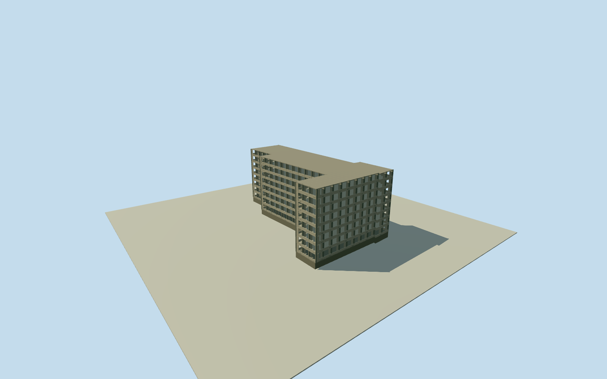

# Ducor Hotel — complete historical concrete ruin

Whole Ducor Hotel main physical concrete building, all original concave native footprint wings/recesses, eight floors and exposed balconies/openings, full roof and top-floor restaurant terrace. Original quantized z15 numeric whole-hotel polygon and paired named POI/Q1263572; primary first-hand written eight-floor/concrete/balcony/ruined-shell/rooftop-restaurant facts. All precise section/column/opening/balcony/roof detail/finish/grade estimates. Independently mapped reservoir, detached pool/tennis courts and outbuildings excluded as separate objects; no property/campus/sample-unit proxy. Historical2016 ruin phase, no current replacement.

Authoring state: **review-in-qa.json**. Current completion evidence is in [qa.json](qa.json) and the [completion ledger](../../../../qualla-structures/batches/qualla-002.PROGRESS.md).

- [Ducor Hotel: Africa's Five-Star Ruin](https://qualla.com/ducor-hotel/)

Whole Ducor Hotel main physical concrete building, all original concave native footprint wings/recesses, eight floors and exposed balconies/openings, full roof and top-floor restaurant terrace. Original quantized z15 numeric whole-hotel polygon and paired named POI/Q1263572; primary first-hand written eight-floor/concrete/balcony/ruined-shell/rooftop-restaurant facts. All precise section/column/opening/balcony/roof detail/finish/grade estimates. Independently mapped reservoir, detached pool/tennis courts and outbuildings excluded as separate objects; no property/campus/sample-unit proxy. Historical2016 ruin phase, no current replacement.

Primary written first-hand visit accounts only: Alastair McCready29November2016 reports eight floors, concrete balcony-laden shell, exposed windows, long pillared corridors, gutted interior and top-floor restaurant/sea-facing terrace. Successfully read actual webpage text; directHTTP403/localPythoncertificate failure disclosed, no originalHTML bytes claim. Fuad directHTTP200 eyewitness account independently reports eight storeys/concrete ruin/rooftop restaurant; publication year unverified. No photos, captions or figures used for shape.

Original numerical20261029z15 entire concave twelve-control hotel way1513039481 and paired same-ID named POI independently bound Q1263572. All wings and native boundary recesses retained; quantized/generalized current map, not original OSM nodes or a measured historical footprint. Actual hotel POI is80.26m from original story pin; model uses hotel point selected before terrain, story coordinate untouched.

Complete eight-floor main hotel, floorplates/full roof and all exterior facades. Separate reservoir/pool/tennis courts/garages/landscaped property excluded as independent objects. No one-wing/facade/sample-unit substitute. All levels retain whole physical building and eight open shell floors.

All exact vertical sections and roof/slab divisions estimated: floor0.35m, eight equal3.25m levels, roof26.35m relative provider datum, foundation to-2.15m.26m generic map-product height is nonsurveyed context, used as estimated total roof height, nominal4m height uncertainty. Real unequal floor heights/roof-restaurant divisions unknown. All main sections fixed before geometry and retained through review.

Columns, beam/slab/parapet widths, balcony depth, exposed rectangular openings/bay counts, restaurant top-floor zoning and original procedural weathering estimated. Exposed openings are true gaps between concrete elements, never opaque black imitation windows. Open interiors have no reconstructed room layout or measured structural design; hotel is an exterior shell model. Upper restaurant is represented by the complete eighth-floor shell and roof/terrace, no invented freestanding rooftop pavilion.

Native12-control boundary used for all full floorplates, cap and main shell. Entire same-level plates at all floors assume a vertical envelope because source data gives no reliable component height partitions; nominal5m component registration uncertainty and20percent facade census uncertainty. Exact balcony distribution/balustrade design unknown; simple concrete sill/parapet forms and recessed partitions are explicit approximate construction.

Weathered gray/beige concrete and darker edges/patches are original procedural estimates; no graffiti or original artwork copied, no photo-matched color/texture or historical signage reproduced. Detailed finishes and damage patterns are not surveyed.

Independent256m/16641-height field/single raw tile acquired before floor and all main sections, datum77.918m, absolute11.4592..80.8603m. Original hill field/frame retained unchanged without mask/flatten/cutout/refetch/refit. Coarse provider heights may overlap lower hotel foundation/floors or create apparent float; historical vertical registration and ground contact unverified.

Dated2016-11-29 ruined hotel phase only, based on dated actual eyewitness text; valid until2017-11-29. Proposed future renovation not represented as built. Qualla first13families, all imagery unused; attribution-only hotel photographs and unrelated public-domain airport images excluded without source questions. No photographic/survey/current replacement claim.

Build: `node content/worldgen/source/places/ec/ec0/ducor_hotel/models/generate-house.mjs`. Add `--check` to verify exact regeneration. 8796 triangles; 4 materials; no embedded photographs.
