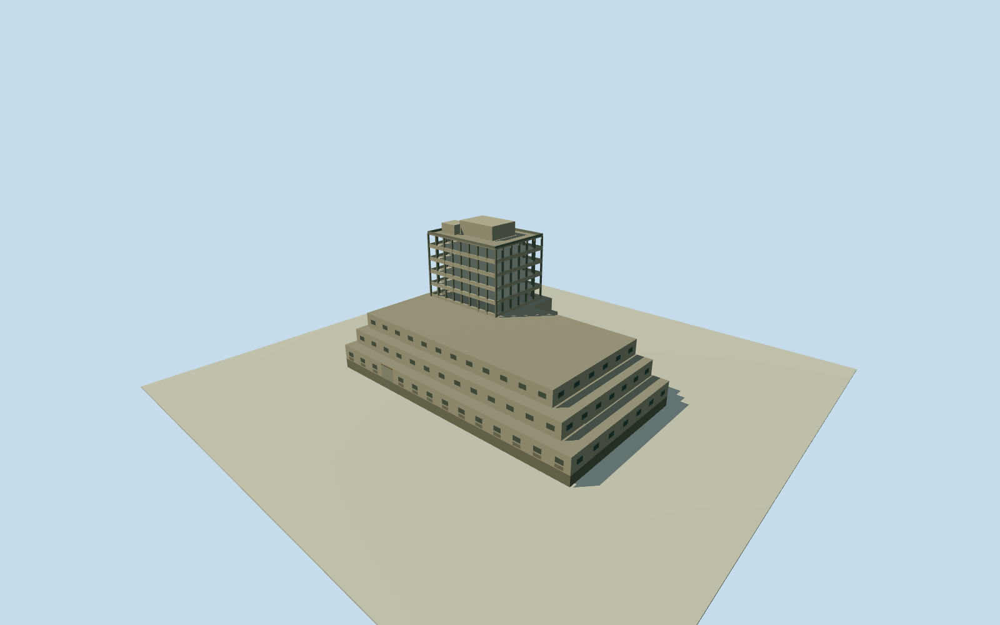

# Edward J. Roye Building — whole tower and tiered podium

Complete EdwardJ.Roye main building, entire original six-control attached podium/auditorium and tiered terraces, central five-floor rectangular tower and all intrinsic roof-service boxes. Primary original researcher preface eightfloors/early2012ruin plus explicitly transmitted same-author chapter opening five-floor tower/tiered plinth/service boxes. Original numeric whole-building way142061466 independently bound by originalHTTP200name/Q1292649tags; no original-node survey claim. Exact tower/terrace/service plans, sections, facades/opening census/finish/grade estimates. Separate CentennialPavilion/otherbuildings excluded, no one-tower/one-facade proxy. Historical2012 only.

Authoring state: **review-in-qa.json**. Current completion evidence is in [qa.json](qa.json) and the [completion ledger](../../../../qualla-structures/batches/qualla-002.PROGRESS.md).

- [Edward J. Roye Building: The Skyscraper That Outlived Its Party](https://qualla.com/edward-j-roye-building/)

Complete EdwardJ.Roye main building, entire original six-control attached podium/auditorium and tiered terraces, central five-floor rectangular tower and all intrinsic roof-service boxes. Primary original researcher preface eightfloors/early2012ruin plus explicitly transmitted same-author chapter opening five-floor tower/tiered plinth/service boxes. Original numeric whole-building way142061466 independently bound by originalHTTP200name/Q1292649tags; no original-node survey claim. Exact tower/terrace/service plans, sections, facades/opening census/finish/grade estimates. Separate CentennialPavilion/otherbuildings excluded, no one-tower/one-facade proxy. Historical2012 only.

Primary researcher DannyHoffman original publisher preface printedxvii/PDFpage14 explicitly describes early2012 ruins and eightfloors. Chapter3 opening construction description actually read as indexed transmission, not original chapter bytes: central rectangular five-floor tower on multistory tiered plinth, smaller service boxes above. Publisher original preview contains no whole chapter. All book/source photos/figures/sketches unused. OwnQualla ten-story narrative conflicts with primary eight-floor record and is not used as measured storey count.

Whole original20261029z15 six-control building way142061466 bound by originalHTTP200OSMnameEdwinJ.Roye/altnameEdwardJ.Roye andQ1292649tags. Full-node request returned429 and was not repeated. Numeric quantized map is not original node survey or measured2012construction plan. Entire attached podium/auditorium included; independentCentennialPavilion/adjacentstructures excluded.

All vertical component extents and heights are estimates: original whole native podium atfloor0.35..4.35m, second/third tiers are original-ring affine scales0.92/0.84 about original published point withtops8.35/12.35m. Three podium floors plus five rectangular tower floors interpret primary eight total levels. Auditorium allocated within complete plinth, interior roof/roomplan not reconstructed.

Estimated central five-floor tower rectangle x-12..13m,z-8.5..10.5m, top30.35m, five3.6mlevels above podium12.35m. Original numerical data supplies no tower-specific footprint/height. All component registration uncertainty nominal10m/20percentplan, main height uncertainty5m. Estimated service boxes above roof: x-5..7,z-4..5m top34.1m andx-10..-5,z2..7m top33.05m. Roof terrace/slab/parapet/census estimates, not source-measured.

Tower represents complete ruined concrete exterior shell and all five floors, with true exposed openings between slabs/columns and full roof. Podium all three tiered floors/facades/terraces preserved at every viewing level. Bay/column census, room divisions, opening widths, concrete panels, entry width, simple abstract broken-glass motif and blank relief panel frames are estimates. No specific VahnjahRichards sculpture/stained-glass artwork or photograph is traced; original protected designs are not reproduced.

Weathered beige/gray concrete, dark slab edges, original abstract colored glass fragments and simplified panel finishes are original estimates, no photographic color/texture/damage pattern claim. Ruined building is not represented as a finished contemporary office or future restoration.

Original256m/16641-height independent field and exact original frame frozen before floors/main sections; no terrain mask/cutout/flatten/refetch/refit or floor/section refitting for review. Provider datum/ground contact and geographic vertical registration unverified; lower podium/entry may overlap original coarse terrain or float.

Historical2012-02-01 preview only, valid until2013-02-01. No current-world replacement. Qualla-first11families; all images, figures, videos and sketches unused. Attribution-only or uncertain architecture/airport/adjacent imagery excluded without source questions. Written primary research facts and original numerical map/identity tags only; no photographic/survey claim.

Build: `node content/worldgen/source/places/ec/ec0/edward_j_roye_building/models/generate-house.mjs`. Add `--check` to verify exact regeneration. 2040 triangles; 4 materials; no embedded photographs.
