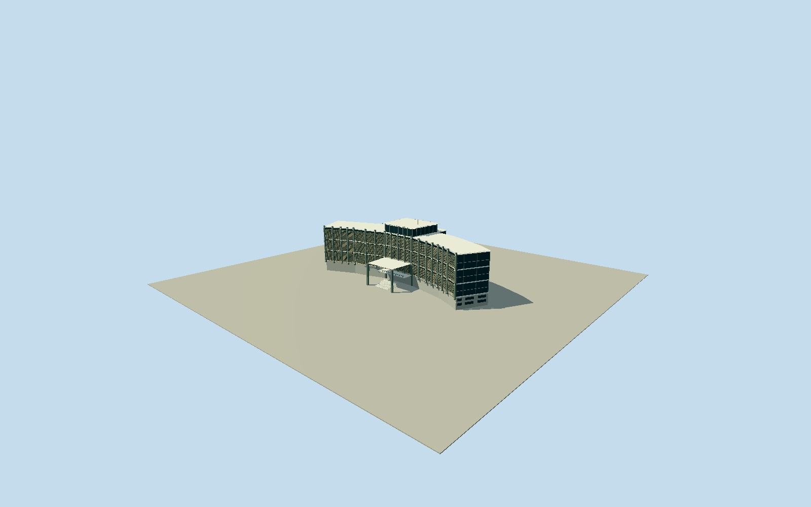

# Executive Mansion, Monrovia

Whole surviving principal Executive Mansion exterior at CapitolHill: actual complete27vertex bent two-wing/nativecentralprojection envelope, wholecore/side/rear/roof, full defining verticalconcrete frame and three paired-height perforated screenbands/dark glazing, central raisedroofpavilion/fins/masts, intrinsic open columned entrancecanopy/balcony/threshold. NamednativeExecutiveMansionPOI lies inside wholeway100219509; adjacent anonymousbuildings not adopted. Exclude fence/estate gates/precinct/yard/CapitolBuilding/nearby presidentialoffices/landscape/roads/trees/people/vehicles/flags and undergroundshelter/pool/rooms. No genericrectangular governmentblock or earlier1850/1922residence substitute. Model the complete original bent native two-wing envelope, not a genericbox. Mainbody around28m/raisedcentralpavilion33.2m/masts37.5m and cosmetic/hiddenprofiles are photo estimates; use darkglass behind actual frontframe/perforatedoliveconcrete screens, three tall screenbands interrupted by whitehorizontal ties and strongverticalgraypilasters. Detail bands have realopen geometriccells, not an opaque screenbitmap; fineexactmotif/census originalapproximation. The intrinsic original projectedentrancecanopy must be physicallyopen undera thinwhiteflatcap with four structuralposts/boundedmidlanding, rather than extrudedsolidfrontblock. Preserve all27nativecontrols including projectedroof corners and mainrearreturns; no sitefloor/yard/fence. Freeze independent400mfield at fixedNEapproach beforegeometry; preserve rawvalues/tiles without flatten/reacquire/fit. Stable principalbuilding, exactpresent cosmeticrenovationunverified.

Authoring state: **review-in-qa.json**. Current completion evidence is in [qa.json](qa.json) and the [completion ledger](../../../../qualla-structures/batches/qualla-002.PROGRESS.md).

- [Executive Mansion, Monrovia: A Palace That Has Seen Everything](https://qualla.com/executive-mansion-monrovia/)

Original native27vertex buildingway100219509, with namedExecutiveMansionPOInode1565176470 inside its actual polygon. Coarse storypoint separately retained; surroundinganonymousblocks/estateboundaries not substituted. Anchor at native mainentrance coreline midpoint(nodes0/23), heading from original projectedcanopyfront corners26to24. Fixed+Xnorthwest alongfront/+Znortheast towardmaingate/+Yup. Original bent two-wing plan/curvature/centralprojectedcanopy/sideandback returns retained, not replaced with an idealrectangular campus. Main28mheight/raisedpavilion33.2m/masts37.5m, levelpartitions, exact screenpattern/windowcensus/hiddenrear profiles are bounded photographs, not a measured current survey.

Whole original27vertex bent modernist mansion envelope and projectedcanopy, complete rear/side/core and raisedroofpavilion. Main28m/pavilion33.2m/masts37.5m/floor partitions are photographic estimates; exactcurrentrestoration/hiddenrear fenestration/services not surveyed. Three defining frontscreenbands/verticalpilasters/whitebands/darkglazing and openentrancecanopy/landing preserve the visible2009structuralcharacter.

Exact2048x1536publishedQuallaPD-selforiginal individually inspected/nativeSHA1matched. First native revision20747356/singleoriginalupload by Nimba-travellor at2009-04-28T15:29:17Z explicitly declaresSourceCamera/Author=my-self/PD-self. Literalcreatorcredit retained with originalaccount evidence, no inventedrealname or siblingmetadata edits. Old1850/1922presidentialresidenceimages are different structures and excluded. No other agency/restricted imagery, photo/generatedbitmap texture, downloadedmesh or fine presidentialseal artwork used.

Detailedscreenbands are genuine open original geometricdiamond lattice with recessedglassbehind; exactoriginalbreezeblock motif/cellcensus/finish is approximated, not claimed reproduced. District uses coarseopenlattice and skyline solidcoloredscreen cues. Lower obscuredstoreys/wingrear/finebalcony/rooftopservices and post2022renovationpaint/glazing repairs remain bounded from a singlewholefront original. Stable principalstructure represented; exact2026cosmeticfitout unverified.

Native projectedcanopy controlpoints locate its upperroof envelope, not surveyedgroundfootings; wholeoriginal maincore and structuralfrontprojection retained. Fourcanopyposts and boundedmidlanding/approachstair are intrinsic, separatefence/gates/yardplatform/nearbyCapitol/officebuildings/landscape/trees/roads/people/vehicles/flags and undergroundshelter/pool/rooms excluded. No whole-site floor.

Independent400m129x129field/16641samples and originalrawsource tilebytes frozen beforegeometry; no fitting/flattening/reacquisition. CompositeDEMmay containstructure/vegetation/outliers, not surveyed thresholddatum. Portable/shared/context use separateflatinspectionground. Nativeplacement preview/replaceFootprint=false; exactestategrade/threshold/footing/compatiblehostattachment unverified.

Build: `node packages/worldgen/scripts/generate-authored-places.mjs --ids=executive_mansion_monrovia`. Add `--check` to verify exact regeneration. 43978 triangles; 6 materials; no embedded photographs.
