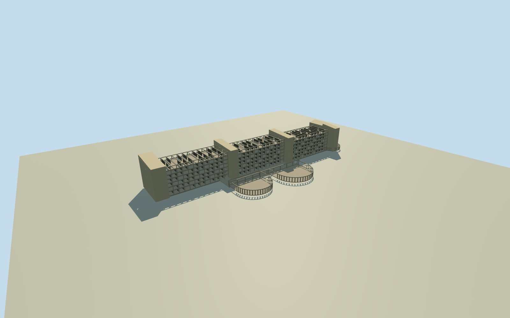

# Hotel Africa, Liberia (2025 ruin)

Whole main Hotel Africa ruin as photographed2025: all three stepped seven-storey room wings, tall end/intermediate service bodies, open concrete frame and missing room roofs, both intrinsic curved coastal halls and attached terminal low wing/lobby connections. Detached resort villas/conference center/casino/pool/golf/landscape excluded. Main-body plan, hidden sections and damage pattern reconstructed approximately from exact full-building CC0 original and primary fieldwork text; no measured building outline claimed.

Authoring state: **review-in-qa.json**. Current completion evidence is in [qa.json](qa.json) and the [completion ledger](../../../../qualla-structures/batches/qualla-002.PROGRESS.md).

- [Hotel Africa](https://qualla.com/hotel-africa/)

Whole main Hotel Africa ruin as photographed2025: all three stepped seven-storey room wings, tall end/intermediate service bodies, open concrete frame and missing room roofs, both intrinsic curved coastal halls and attached terminal low wing/lobby connections. Detached resort villas/conference center/casino/pool/golf/landscape excluded. Main-body plan, hidden sections and damage pattern reconstructed approximately from exact full-building CC0 original and primary fieldwork text; no measured building outline claimed.

Full-building CC0 original and primary seven-storey fieldwork support whole geometry. Exact lengths/wing offsets/cores/halls/hidden rear/sections/damage pattern/finish and historicgrade are estimates.

Native API429 respected; no alternate endpoint/request bypass. Saved native coastline full144nodes covers actual site and controls bearing. Public compiled named-point coordinate and official road endpoint corroborate approximate placement; direct native point/footprint not claimed.

Original approximate spatial frame and independent field before all floors/roof/main sections/geometry, then preserve without flattening/refit.

Exact native3840x2160 original bytes and creatorCC0 release retained; inspection display resized. Seven-storey typology comes from primary fieldwork; all numeric lengths/heights/bays/offsets/cores/halls are explicit estimates, not orthophoto/photogrammetry or survey.

Full room wings retain every floor slab, front/back structural voids, balcony spandrels/columns and missing roofs. Hidden internal partition remnants and damage edges are stylized estimates; no copied graffiti/art/furniture/plants or black facade-image substitute.

Five service bodies include two parts of terminal return, not five separate buildings. Two maincurvedhalls plus intrinsic terminallowwing; detached casino/villas/conferencecenter/pool/golf/landscape excluded.

The photo-based estimated plan is not a measured native building outline. Placement uses published named ruin point/primary government road-end corroboration and actual nearby cached OSMcoast bearing. Direct native point API remains429 and is not bypassed; exact orientation/registration may vary. Old story/Wikidata coordinate approximately1.6km northwest is not adopted as placement or edited in article.

Original field absolute-1.2425..13.8317m at12.6241m datum preserved. Coarse composite coastal terrain can obscure lowerstructure locally; no surveyed foundation/ground-contact or current2026/redevelopment claim.

Skyline retains all seven main floors, complete room/service/hall body and open skeletal silhouettes, with fewer facade columns/court bands and continuous core slits. District restores moreframe detail; street/closeup add room partitions/roofremnants/stackedcore slits.

Build: `node content/worldgen/source/places/ec/ec0/hotel_africa/models/generate-house.mjs`. Add `--check` to verify exact regeneration. 11600 triangles; 1 materials; no embedded photographs.
