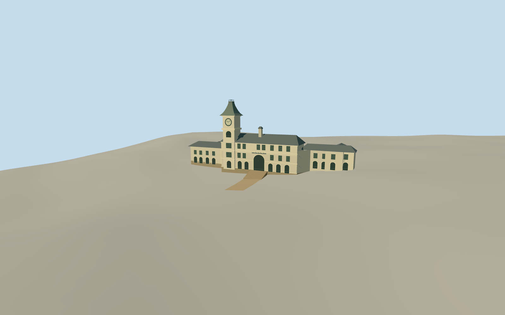

# Achimota School Administration Block

Achimota School’s administration building, with a square offset clock tower, bell-shaped crown, white arched frontage and formal stairs.

Authoring state: **review-in-qa.json**. Current completion evidence is in [qa.json](qa.json) and the [completion ledger](../../../../qualla-structures/batches/qualla-003.PROGRESS.md).

- [Achimota School](https://qualla.com/achimota-school/)

The named school campus is mapped. The actual Administration Block footprint is inferred from the central projection, side ranges and nearby Guggisberg Street connection. Exact component assignment and approach grade are approximate.

The Qualla photograph establishes the clock, wide entrance arch, window rhythm, wings and flared metal tower roof. The upper levels, rear ranges and concealed roof junctions are estimated.

The original terrain is retained. The outer wings use stepped floor levels, and the front stairs follow the approximate local grade.

Build: `node content/worldgen/source/places/ec/ecp/achimota_school/models/generate-achimota-school.mjs`. Add `--check` to verify exact regeneration. 2114 triangles; 6 materials; no embedded photographs.
