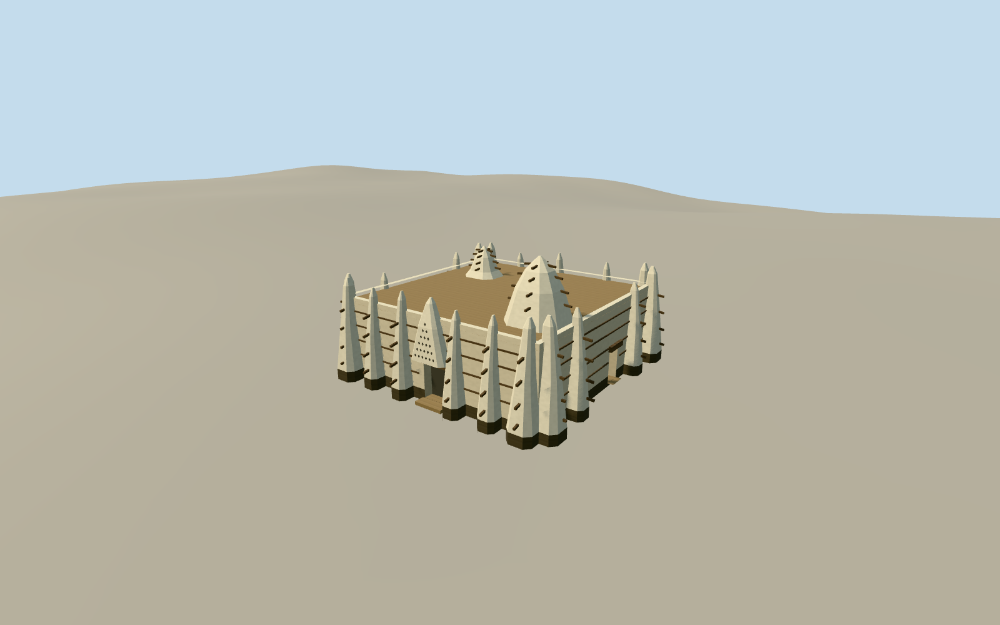

# Larabanga Mosque

Restored Larabanga Mosque with its whitewashed tapered adobe buttresses, dark plinth, timber torons, unequal towers and small patterned entry.

Authoring state: **review-in-qa.json**. Current completion evidence is in [qa.json](qa.json) and the [completion ledger](../../../../qualla-structures/batches/qualla-003.PROGRESS.md).

- [Larabanga Mosque](https://qualla.com/larabanga-mosque/)

The 2010 publication date anchors the whitewashed appearance. The approximate 8m body scale follows the Ghana Museums and Monuments Board. The tower heights, corner profiles, rear door positions and timber sizes are estimates.

The relief of the earthen plaster and the entry grille are simplified for medium-fi viewing. The original terrain field is preserved and threshold registration is approximate.

Build: `node content/worldgen/source/places/ec/ecw/larabanga_mosque/models/generate-larabanga-mosque.mjs`. Add `--check` to verify exact regeneration. 3316 triangles; 4 materials; no embedded photographs.
