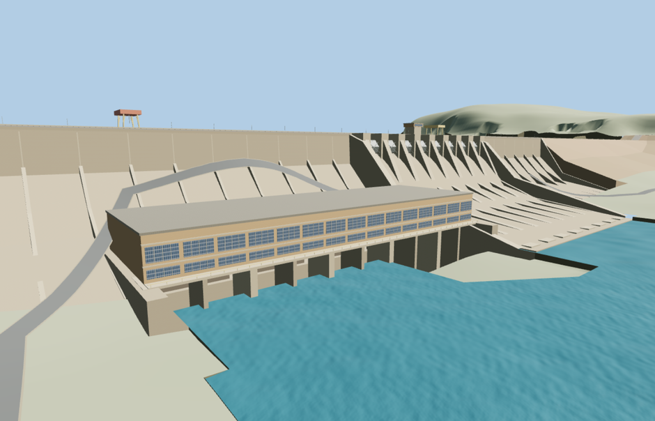

# Manantali Dam

The concrete block and both rockfill wings carry a continuous crest road. The reconstruction includes eight recessed radial gates and chutes, five generating-hall outlets, the control tower and the crest cranes.

The dam follows retained OSM way 190325901. The two crest-road ends meet the rendered service lanes within 6 cm at the sampled centerlines. The native reservoir and tailrace use representative stages of 204.43 m and 162.22 m.

The fixture retains 14 neighboring buildings, the independent RN22 crossing and all independent road records. The viewer replaces the matching generating-hall footprint, two crest bridge fragments and the covered pieces of their connected approaches. Failed loading restores the mapped footprint and all 39 transportation records. Unload restores ground and land cover and releases geometry.

| Detail level | Triangles | Download bytes | Draws |
| --- | ---: | ---: | ---: |
| skyline | 972 | 80,112 | 1 |
| district | 2,772 | 226,984 | 6 |
| street | 3,552 | 291,504 | 6 |
| closeup | 5,906 | 491,892 | 6 |

Skyline and district total 307,096 bytes. Six GLBs, 425 terrain and placement checks and 79 renders passed review.

The water stages and road elevations are representative estimates from retained terrain and exterior photos. The local grades repair anomalous DEM lows and fit the outfall shoulder and southern service turn.

The model depicts closed gates. Hydraulic operation and machinery interiors are outside the exterior scope. Steep banks remain beyond the fitted works.

[Mapped site frame](map-frame.json) · [Terrain and water fit](site-fit.json) · [QA evidence](qa.json)
