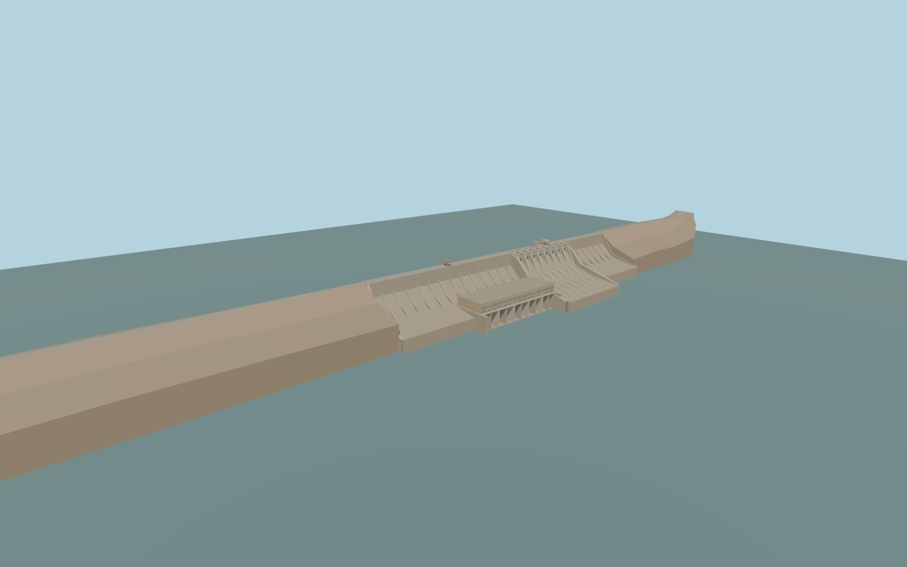

# Manantali Dam

Manantali’s central concrete dam with its eight gated spillways, ochre generating hall and five tailrace outlets, the crest control tower and gantries, and both rockfill wings.

Rebuild: `node packages/worldgen/scripts/generate-manantali-dam.mjs`;append `--check` for exact source bytes. Select import/LOD/placement with `--ids=manantali_dam`. Detailed source and four browser tiers are separate ignored GLB outputs.

A fixed 204.42666 m datum aligns the signed crest, eight spillway gates and five powerhouse outlets. The authored crest road runs between the two mapped service road turns. The native reservoir and tailwater use representative stages of 204.43 m and 162.22 m.

Both road joins use the mapped plan and the representative terrain grade. The equipment and exterior details follow the retained ordinary images.

The viewer depicts a steady reservoir and tailrace with the gates closed. The levels illustrate a representative operating state.

Bounded terrain repairs lift isolated invalid raster lows near the dam. Source terrain tiles are preserved. The downstream channel and neighboring terrain remain approximate.

Original geometry:repository license. Map:© OpenStreetMap contributors,ODbL-1.0;Protomaps. Standard terrain:terrain-grid.json. Ordinary pictures stay local and are not redistributed or used as textures. Current acceptance:qa.json.
