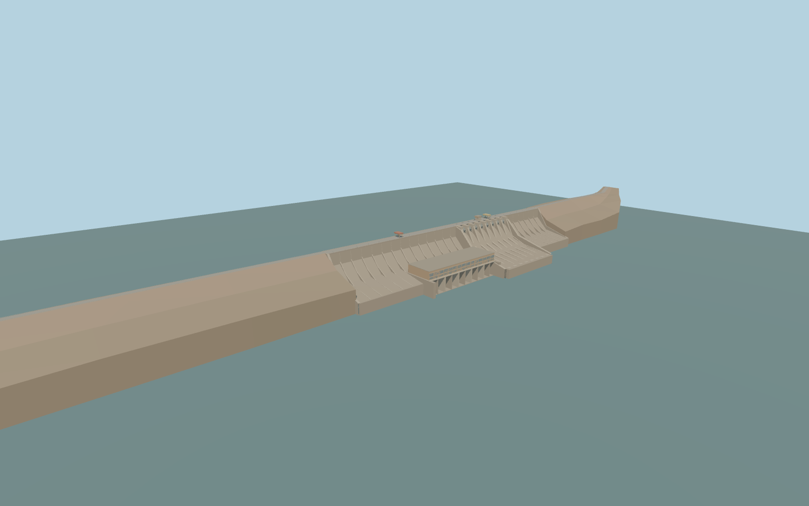

# Manantali Dam

Manantali’s central concrete dam with its eight gated spillways, ochre generating hall and five tailrace outlets, the crest control tower and gantries, and both rockfill wings.

Rebuild: `node packages/worldgen/scripts/generate-manantali-dam.mjs`;append `--check` for exact source bytes. Select import/LOD/placement with `--ids=manantali_dam`. Detailed source and four browser tiers are separate ignored GLB outputs.

The unmodified standard terrain uses a 204.43 m pond reference. The sampled reservoir windows range from 202.37 to 211.92 m and the downstream windows from 162.22 to 192.28 m. A damaged south-bank tile contains isolated anomalous elevations.

The crest road and both rockfill flanks follow the native axis. Concrete and machinery dimensions use project references and estimated local proportions.

The reference fixture shows a continuous reservoir and a 162.22 m tailrace. The sampled-water comparison shows the individual window stages and its boundaries are illustrative.

Ground heights remain unchanged. Terrarium tile 14/7717/7586 contains a −1,680.49 m pixel amid neighboring 239–244 m elevations, leaving sharp defects in the nearby reservoir bank. Site acceptance remains pending.

Original geometry:repository license. Map:© OpenStreetMap contributors,ODbL-1.0;Protomaps. Standard terrain:terrain-grid.json. Ordinary pictures stay local and are not redistributed or used as textures. Current acceptance:qa.json.
