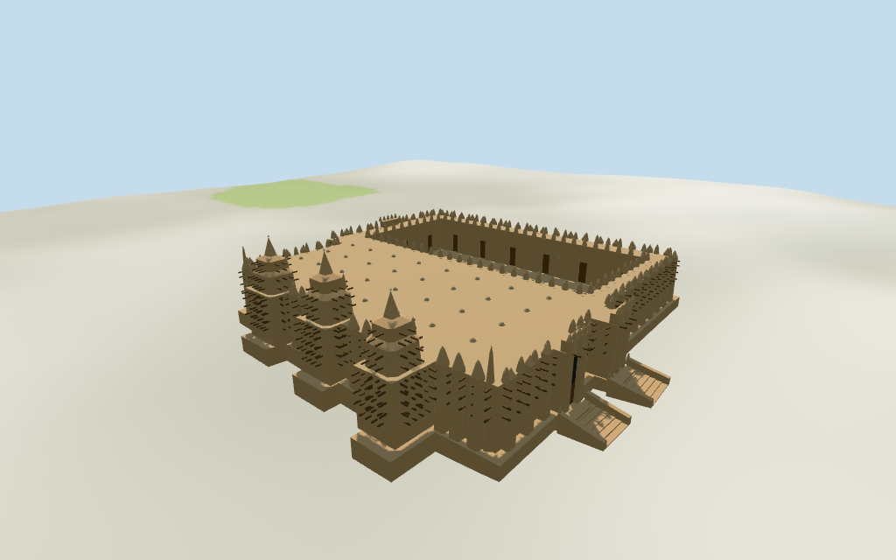

# Great Mosque of Djenné

Individual medium-fi Great Mosque of Djenné:three footprint-aligned tapering earth towers/stepped shoulders/conical tips/pale finials,buttressed qibla facade,pointed parapets,projecting timber toron,flat earthen roof/low clay vent lids,open mapped courtyard and selected rectangular gates/raised cheek-walled stairs. Existing shared plaster and timber graphs,six semantic groups,four browser levels. Raw mapped ring/hole and nominal facts retained;all architectural partitions,current finish and exact site joins explicit approximations.

## Evidence and reconstruction

Published dimensions and reconstructed details are separated in spec.json. Primary references:

- [Reference](https://commons.wikimedia.org/wiki/File:Moschee_von_Djenn%C3%A9.jpg)
- [Reference](https://commons.wikimedia.org/wiki/File:Djenn%C3%A9_Moschee(Dach)1990.jpg)
- [Reference](https://commons.wikimedia.org/wiki/File:Mosque_entrance_(6862566).jpg)
- [Reference](https://commons.wikimedia.org/wiki/File:La_Grande_mosqu%C3%A9e,_Djenn%C3%A9,_Mali._Le_toit_et_ses_%C3%A9vents_d%27a%C3%A9ration._Date_du_clich%C3%A9_1972-12-27.jpg)

Two existing shared256² plaster and plain timber graphs;six semantic groups. Earth-colored walls/roof and pale egg-like finials share neutral plaster;timber pegs and doors share wood. Smooth plaster represents the observed coating without exposed brick joints. Metric UVs,linear tints,no embedded images,baked lighting,unique artwork or copied inscriptions.

## Model and axes

23,113 triangles; 69,339 vertices; 6 material groups; 2,777,308 bytes. Native bounds: -31.472, -0.477, -34.754 to 31.372, 18.712, 34.684. Source hash: `sha256:f7810b779bbd80f95e9aa6890f8bd3ad0fc91d894e57f208e6e80d6418d6a943`.

{"x":"east qibla facade and three towers","y":"up","z":"south side"}

Standard viewer DEM datum273.991343m;whole perimeter-0.15 to1.11m relative to datum. Platform floor2.712m is maximum perimeter sample plus1.6m. Earth footings extend below retained terrain and crossY=0. Coarse DEM/platform height may expose tall footings or door gaps. No cutout,terrain flattening or road replacement. Stair lower landings use DEM samples,not surveyed street levels;exact ground,platform,court,door,step and street contact,altitude and walking unverified.

## Reproduce

Run `node packages/worldgen/scripts/generate-additional-landmarks.mjs --ids=N0423` (or add `--check`). The generator preserves manually edited masters by checking their baseline hashes. Import through the standard authored-model workflow with optimization disabled; then capture all QA cameras, including shared-surface views.

## Pending work

- Retained exact relation/11916275 /Q683632 identifies the Great Mosque of Djenné. Current PMTiles whole52776570049523 (3×2^44+11916275) retains26 outer and4 courtyard-hole points/properties,one fragment. Anchor[-4.555439256,13.905098912] and heading−0.017237667395rad unchanged,no horizontal rescale. Native+X east qibla facade/three projecting towers,−X west open courtyard,+Z south,−Z north. Pictures resolve east facade facing with about3° uncertainty. Tower bases follow the three east footprint projections;courtyard uses its mapped ring. Buttress cadence,taper,toron rows,gates and stairs are picture-led working estimates with about2m horizontal uncertainty. Standard map footprint is about60×59m;retained nominal75×75m facts have no linked references and may describe a wider platform,so they do not rescale this building. Separate markets,streets,city buildings and landscaping remain host assets.
- Retained facts supply nominal16m height and75×75m dimensions without linked references;current mapped whole has height10m. Preserve those facts separately. Working exterior uses16m central tower tip,15.4/15.1m side tips,7.4m roof,roughly9.5m pointed buttress/parapet crest and10m gate masses. Tower shoulders,cone/egg shapes,wall thicknesses,toron spacing and vent/stair dimensions are picture estimates,not surveyed measurements. Platform plane uses maximum retained perimeter DEM plus1.6m,consistent only approximately with the photographed raised stairs. Current finish,unseen court elevations,interiors and precise site/door/street joins remain unverified.
- Standard viewer DEM datum273.991343m;whole perimeter-0.15 to1.11m relative to datum. Platform floor2.712m is maximum perimeter sample plus1.6m. Earth footings extend below retained terrain and crossY=0. Coarse DEM/platform height may expose tall footings or door gaps. No cutout,terrain flattening or road replacement. Stair lower landings use DEM samples,not surveyed street levels;exact ground,platform,court,door,step and street contact,altitude and walking unverified.
- Individual medium-fi exterior from four inspected1972/1990/2005/2007 facade,roof and entrance pictures plus standard viewer PMTiles/DEM. Three tapered stepped towers/conical tips/pale finials,pointed buttresses and parapets,timber toron,flat roof vent lids,mapped open courtyard and selected paired rectangular entry fields/cheek-walled stairs. Exact peg/vent count,current annual plaster finish,courtyard elevations,unseen faces,fine ornament and actual interiors simplified or unverified. Door/vent fields terminate closed;courtyard is exterior open space,no enclosed-interior or free traversal claim. Nominal75m dimensions do not rescale60m map footprint. Ground/stair/threshold joins,altitude,walking and physical-device timing unverified. Neighboring city/market assets excluded.

This bundle follows the medium-fi standard. Medium-fi appearance and geographic fit are reviewed separately. Hash-bound visual acceptance is recorded separately after capture inspection.

## Additional geographic data

©OpenStreetMap contributors;Protomaps;Mapzen/USGS terrain tiles.
