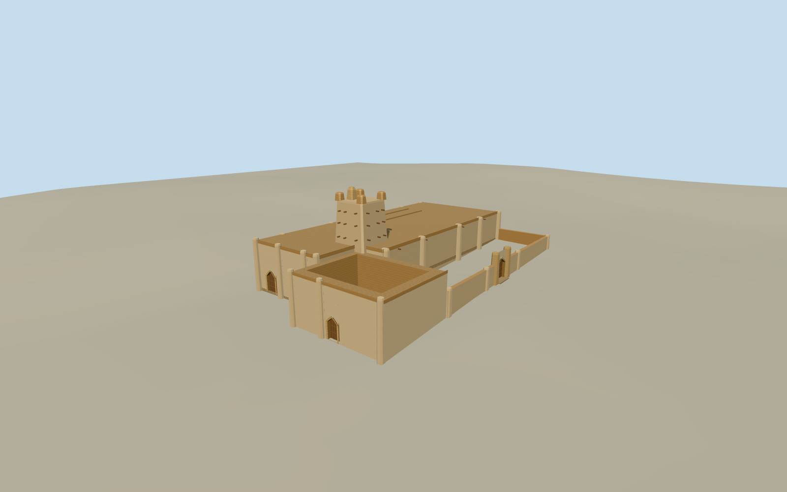

# Sidi Yahya Mosque

An earth-and-stone mosque with a tapered timber-studded minaret, flat prayer hall, rounded eastern mihrab and a low western court surrounding the rebuilt wooden gate.

Authoring state: **review-in-qa.json**. Current completion evidence is in [qa.json](qa.json) and the [completion ledger](../../../../qualla-structures/batches/qualla-003.PROGRESS.md).

- [Sidi Yahya Mosque](https://qualla.com/sidi-yahya-mosque/)

The mapped prayer hall and adjacent northwestern outline provide the exterior boundaries. The western court enclosure, setback, internal walls, roof levels and minaret height use approximate dimensions.

The early public-domain images show the structure before the 1939 work. Present-era pointed arches, stone facing and the reconstructed timber gate are based on written accounts and approximate architectural details.

The original terrain is preserved. Finished courtyard grades and thresholds are approximate at available DEM resolution.

Build: `node content/worldgen/source/places/ef/efv/sidi_yahya_mosque/models/generate-sidi-yahya-mosque.mjs`. Add `--check` to verify exact regeneration. 2342 triangles; 5 materials; no embedded photographs.
