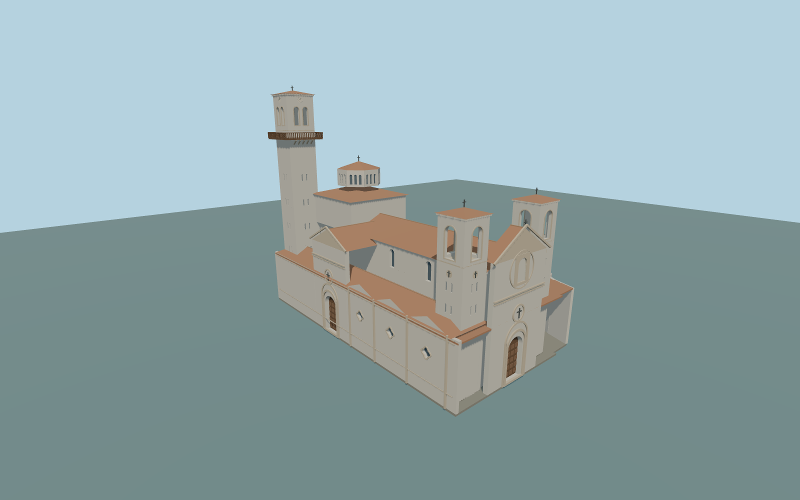

# Basilica of Candelaria

Complete principal Basilica of Candelaria exterior within its irregular native parent footprint:short WNW entrance withtwin squat open-belfry towers,closed framed main door,niche/pediment/cross,long NNE plaza-side facade withthree quatrefoil windows andprojecting closed side portal,clerestory/nave andaisle roofs,crossing cube andpierced octagonal lantern,all connected principal side/rear returns,andthe tall45m rear ESE clock/bell tower withprojecting wooden gallery,open paired arches andtiled cap. Separate convent/hospice,plaza,statues,furniture andneighbors remain native. Original geometric trim/medallions only;no copied sculpture,lettering orclaimed navigable interiors.

Rebuild: `node packages/worldgen/scripts/generate-basilica-of-candelaria.mjs`;append `--check` for exact source bytes. Select import/LOD/placement with `--ids=basilica_of_candelaria`. Detailed source and four browser tiers are separate ignored GLB outputs.

Complete principal Basilica of Candelaria exterior within its irregular native parent footprint:short WNW entrance withtwin squat open-belfry towers,closed framed main door,niche/pediment/cross,long NNE plaza-side facade withthree quatrefoil windows andprojecting closed side portal,clerestory/nave andaisle roofs,crossing cube andpierced octagonal lantern,all connected principal side/rear returns,andthe tall45m rear ESE clock/bell tower withprojecting wooden gallery,open paired arches andtiled cap. Separate convent/hospice,plaza,statues,furniture andneighbors remain native. Original geometric trim/medallions only;no copied sculpture,lettering orclaimed navigable interiors.

Retained45m tall tower and53.756by36.496m footprint guide the envelope. Current parent5m isnot full church height. Twin front towers28.55m,nave ridge21.25m,crossing lantern31.9m,portal/gable dimensions,clock/gallery andhidden roof inventory arepicture-proportioned approximations. Y=0 usesone host sample at the anchor,standard field19.565622m;finished floor+.3m andburied source support-8m. The unchanged coastal field isapproximate;exact steps,paving,door thresholds andhistoric grades arenot surveyed.

Two ordinary exterior pictures actually inspected,current standard PMTiles andtwo unchanged global Terrarium tiles only. Rear/interior inventory,abstract ornament,clock hands,window spacing andfine material proportions remain approximate. No bespoke survey,downloaded mesh,private texture,inscriptions orsculpture. Numerical LOD surface error andphysical phone/laptop timings areunmeasured.

Seven existing shared256px lime plaster,raw limestone/basalt,ceramic tile,plain wood,painted metal andpunched window graphs in seven groups maximum;metric UVs,linear colors,no embedded/private images. Skyline usesclosed shaft solids,two visible rectangular belfry proxies,flat gallery rails,roof/floor shell proxies andomits fine slots/niche;district usesone lantern arch perface;street/closeup/master retainpaired tower arches,finer clocks/slots andthree lantern arches perface. Detailed source preserves thefull support separately.

Original geometry:repository license. Map:© OpenStreetMap contributors,ODbL-1.0;Protomaps. Standard terrain:terrain-grid.json. Ordinary pictures stay local and are not redistributed or used as textures. Current acceptance:qa.json.
