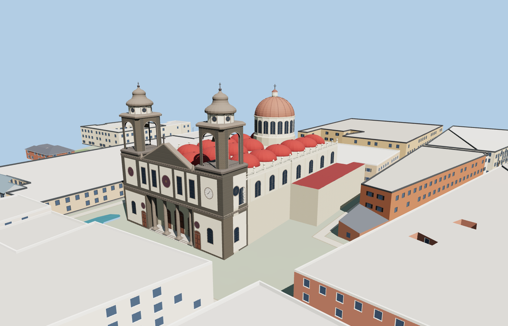

# Cathedral of La Laguna

Cathedral of La Laguna with its volcanic-stone and white-plaster façade, recessed columned portico, two open bell towers, rows of red roof cupolas, and a raised crossing dome.

The 43,903-triangle source rebuilds byte for byte. Skyline, district, street and close-up use 995, 3,838, 15,295, 37,099 triangles. The first two tiers total 394,708 bytes. Six GLBs validated and 38 current views were inspected.

Each tier passes three portico, two belfry, nineteen foundation, four stair and eighteen cupola probes. The two bell towers and crossing dome rise about 40 m above the sampled site datum. The viewer retains 56 independent building records and 27 mapped transportation parts. Failed loading retains the native cathedral footprint.

The PMTiles outline fixes the footprint and orientation. Photos guide the exterior detail, cupola spacing, dome and portal proportions. The modeled portico and belfries are open exterior spaces. Closed doors and glazed apertures represent the rest of the cathedral exterior. Physical-device timings are unmeasured.

Rebuild with `node packages/worldgen/scripts/generate-la-laguna-cathedral.mjs`. Append `--check` to compare exact bytes. Use `--ids=cathedral_of_la_laguna` for targeted import, LOD, placement and readiness.
