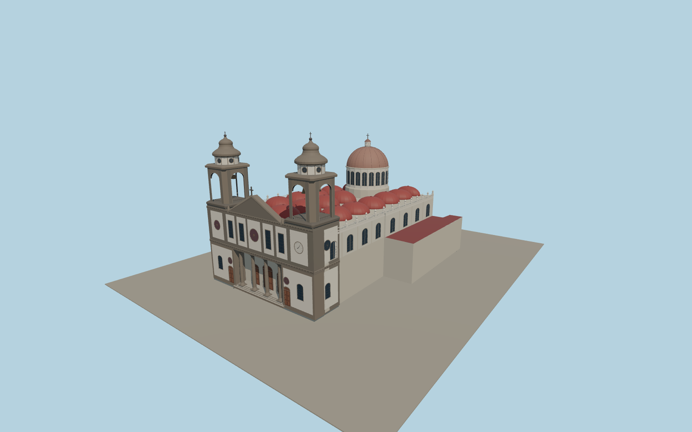

# Cathedral of La Laguna

Cathedral of La Laguna with its volcanic-stone and white-plaster façade, recessed columned portico, two open bell towers, rows of red roof cupolas, and a raised crossing dome.

Run `node packages/worldgen/scripts/generate-la-laguna-cathedral.mjs` to rebuild the source master. Append `--check` to compare the exact bytes. Use `--ids=cathedral_of_la_laguna` for targeted import, LOD generation and placement.

The PMTiles outline fixes the footprint and orientation. Photos guide the exterior detail, cupola spacing, dome and portal proportions.

The modeled portico and belfries are open exterior spaces. Closed doors and glazed apertures represent the rest of the cathedral exterior.

Original geometry follows the repository license. Map data is © OpenStreetMap contributors under ODbL-1.0 via Protomaps. Terrain samples are described in terrain-grid.json. Ordinary pictures stay local and are not redistributed or used as textures. Current acceptance is recorded in qa.json.
