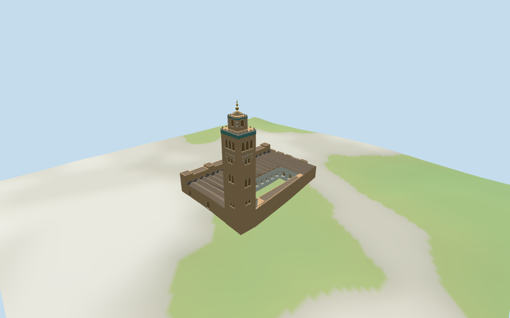

# koutoubia_mosque — Koutoubia Mosque

Reviewed2026-10-17 against current bytes. Accepted for the stated medium-fi exterior and approximate map fit. Exact retained relation/QID identity;the conflicting unqualified68m fact,finial partitions,precise doorway bearing,current condition,unseen interior and terrain joins remain explicitly limited.

## Exterior and shared surfaces

Actually inspected all11 final portable frames,including the1024×640 summary. Tall square minaret,green friezes,pointed crest,smaller lantern,ribbed ochre cap and three-globe finial;parallel brown pitched naves,raised transverse bays,attached southern annex,ochre outer walls and pale inner arcade around two open map courts. Replaced four-corner roof assumptions with full mapped side chains,cleared relief diamonds from actual lantern windows,and deepened the court galleries with ochre backs and selected wood doors. Lowered the court camera to show the arches. Exact lobed/horseshoe profiles,carving,door layouts,current finish and terrain joins remain approximate.

Actually inspected all11 final shared/geographic-flat views. Seven existing256² sandstone,limestone,lime plaster,fired-clay,mosaic tile,plain wood and cast bronze graphs;seven merged roles with metric UVs and linear tints. Every graph read once;unload zero live model geometries. No embedded images,unique atlas,baked lighting,photographic art or copied inscriptions. North-up compound outline and both court openings align with the retained heading. The shared fixture is flat;portable/medium-fi retain standard DEM. Detail shots crop adjacent forms;whole views cover the compound. A wood proxy closes each modeled tower window;this does not reconstruct its interior.

## Browser levels

| Level | Triangles | Bytes | Draws |
| --- | ---: | ---: | ---: |
| skyline | 903 | 97,320 | 1 |
| district | 3,716 | 382,276 | 7 |
| street | 9,972 | 1,046,868 | 7 |
| closeup | 10,036 | 1,053,444 | 7 |

Initial skyline plus district:**479,596 bytes**. Master **1,208,652 bytes /10,036 triangles**;runtime **1,208,020 bytes**. Seven existing shared256² graphs/seven merged roles,zero embedded images;shared textures are additional.

Actually inspected all27 final medium-fi views:Economy/High,noon/late,three distances,silhouette,six details,four matched browser levels and four transitions. Whole skyline also inspected full size. Skyline903 retains square shaft/lantern,green bands,coarse pointed crest,cap/globes,two courts and the pitched-roof rhythm;windows and arcade mouths use flat proxies. District3716 adds spatial gallery recesses,more window groups and finer crest. Street9972/close10036 add selected gallery doors,arch surrounds,roof parapets and original sparse relief kept clear of windows. Initial479596 bytes plus shared textures;one/seven draws,separate attribute streams and equal CPU/GPU reservations. Court shadow is supplied by scene lighting. Roofs stay brown;green belongs to tower tile bands. Synthetic surroundings,device timing and navigability remain unverified.

## Placement and scope

Retained OSM relation12255861 has exact Q1137533 and supplies the compound anchor/axis. Current encoded relation52776570389109 matches its distinctive open court and service void;individual current height-tagged roof parts,shaft/lantern/cap and a contiguous southern annex constrain the exterior. Original anchor[-7.993581375,31.623738656] and heading0.378293139479rad retained. PositiveX runs toward the tower/eastern side of this local frame;negativeZ toward the tower/court front. Exact facade hand follows the mapped tower corner and inspected pictures,with15-degree visual orientation allowance;not a surveyed doorway bearing. Current height controls retained:main shaft62m,lantern min_height62/top69m,cap min_height69/top71m;roof bays10/11m,south bays13/14.5m,outer wing parts7.5/9m and attached annex8m. The source68m height claim has no qualifier defining its datum and differs from current mapped tower tags. It remains in the source fact field without silently rescaling those controls. The cap is a shallow ribbed masonry dome guided by the aerial picture;an estimated bronze finial with three broad globes ends76.5m above the tower working plane.68m is not claimed as a measured finial or shaft datum. Exact height partitions,ornament counts and current condition remain unverified. The12.5m width claim is retained as a tower-scale comparison;current mapped footprint controls the actual shaft. Standard viewer DEM datum465.550273m. Hall and tower floors use independent maximum2m/vertex samples plus0.25m:hall:2.846627m (1196samples,-0.531..2.597); tower:0.818348m (48samples,-0.343..0.568). Footings extend below retained terrain;no flattening/cutout. DEM does not resolve exact courtyard paving,steps or archaeological terraces;thresholds and walking remain unverified. All360 viewer-footprint checks cover42 selected controls,preserve15 separate nearby buildings,and keep three samples in the two courts unfilled across six files. All212 raw map points/properties independently reunited from current PMTiles. The22 pitched bays retain every mapped side-chain vertex;the37 roof/wing components retain their height tags. Two working planes reproduce1196 hall/annex samples and48 tower samples. Exact thresholds,courtyard paving,archaeological terraces and walking remain unverified.

Individual medium-fi Koutoubia mosque exterior:original mapped compound with two unfilled courts,parallel brown nave roofs,transverse raised bays,ochre walls/selected horseshoe doors,pale inner arcade,and tall square minaret with different facade fields,green tile bands,pointed parapet crest,smaller lantern,ribbed ochre cap and globe finial. Seven existing shared256² graphs,seven merged roles,four authored browser levels. Exact roof details,carvings,room plans,current condition and walking remain approximate or unverified. Current height controls retained:main shaft62m,lantern min_height62/top69m,cap min_height69/top71m;roof bays10/11m,south bays13/14.5m,outer wing parts7.5/9m and attached annex8m. The source68m height claim has no qualifier defining its datum and differs from current mapped tower tags. It remains in the source fact field without silently rescaling those controls. The cap is a shallow ribbed masonry dome guided by the aerial picture;an estimated bronze finial with three broad globes ends76.5m above the tower working plane.68m is not claimed as a measured finial or shaft datum. Exact height partitions,ornament counts and current condition remain unverified. The12.5m width claim is retained as a tower-scale comparison;current mapped footprint controls the actual shaft. Standard viewer DEM datum465.550273m. Hall and tower floors use independent maximum2m/vertex samples plus0.25m:hall:2.846627m (1196samples,-0.531..2.597); tower:0.818348m (48samples,-0.343..0.568). Footings extend below retained terrain;no flattening/cutout. DEM does not resolve exact courtyard paving,steps or archaeological terraces;thresholds and walking remain unverified. Curved arch fields,2.6m gallery depths,wood door/window proxies,parapet cadence,roof eaves/joins,cap ribs and three finial globes are visualization estimates. The68m source height remains unqualified and is not silently turned into a surveyed shaft/finial datum. Current map62/69/71m controls remain intact;modeled finial reaches76.5m above its own working plane. Adjacent excavated foundations and gardens are separate context and are not reconstructed. Three inspected pictures guide appearance;no bespoke research or redistributed pixels. Current restoration,unseen rooms/stairs,exact ornament counts,ground steps and physical-device performance remain unverified.

## Verification

**49 current views inspected;830 geometry probes;360 footprint checks.** Six Khronos validations:zero errors/warnings/images. Targeted byte reproduction,scene validate/sim30,recipe-only Biome and current recipe/input/model/LOD/report/capture/material bindings pass. Seven graphs read once;unload zero live model geometry. Current package builds reused;next full source checkpoint great_mosque_of_aleppo–great_mosque_of_xi_an.

Source:sha256:6487e616f979da9674b03e3c1627fafb2c5488472440398f66f656c03f3b79cd

Runtime:sha256:550f6b0fa19c6be8b38e65320469ff2d02337273c608c6bbfefac48c9744f476

Input:sha256:707ad148a091ff9003412464672749d7a6c171a101d129b9a21476cc0c8d8be9

Simulation:sha256:a3b102ee40ac1f019465596812963482916142437fa0baed0247744a17cfbe00

Commands:targeted generate/import/LOD/register --ids=koutoubia_mosque;generate --check;portable reflections/antialias/fitted shadows;shared reflections/adaptive clipping/bounded placement;medium-fi reflections;scene validate/sim30;recipe-only Biome. Bulk captures remain ignored.

## Inspected pictures

[R Prazeres — 2015-05-30](https://commons.wikimedia.org/wiki/File:Koutoubia_minaret_DSCF8275.jpg). CC-BY-SA-4.0. Actually viewed western/northern minaret facades:ochre square shaft,staggered paired arched window fields,large upper arcade,green/cream tile frieze,pointed parapet merlons,smaller square lantern and globe finial. Thin carving/lattice is abstracted rather than copied.

[OussamaHamama — 2024-06-28](https://commons.wikimedia.org/wiki/File:Kutubiyya_Mosque_from_a_different_angle.jpg). CC-BY-SA-4.0. Actually viewed east facade:ochre masonry,wooden horseshoe door,pale inner arch trim,lobed outer portal surround,low tiled eave and tower behind. No copied inscriptions;selected door/recess rhythm only.

[Office National Marocain du Tourisme page;photographer unspecified — Viewed2026-10-17;photograph date unspecified](https://www.visitmorocco.com/fr/node/2049). Reference viewing only;no redistribution license asserted. Actually viewed overhead picture:parallel dark brown pitched roof strips,raised rectangular roof pavilions,pale inner court arcade,ochre outer shell,green/cream tower friezes,ribbed ochre lantern cap and golden globes. Adjacent excavated foundations are separate ground context and are not reconstructed.
