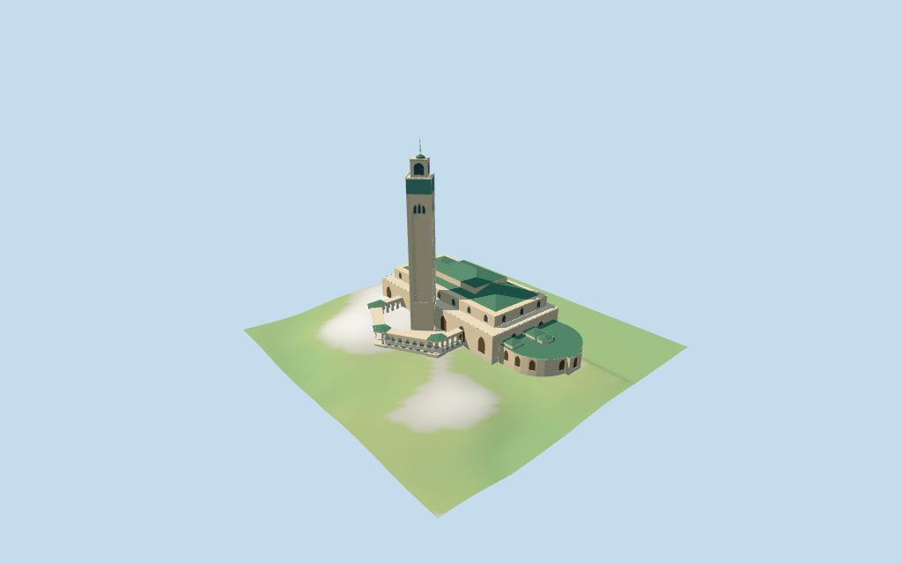

# Hassan II Mosque

Individual medium-fi Hassan II Mosque:nominal210m diamond-oriented square minaret with long shallow diagonal/arched fields,green mosaic cornice band,setback upper stage/rounded cap/stacked-ball finial;stepped27/40m prayer hall with nested green50/60m hip roofs,large entry/clerestory fields,polygonal open courtyard/thick-pier Moorish galleries and small green pavilion caps,curved east ancillary wing and mapped entrance projections. Six existing256² shared stone/marble/glazed-tile/mosaic/wood/bronze graphs,seven merged groups,four browser levels. Exact map controls and nominal height bands retained;fine carving/current finish/terrain and shoreline contacts remain approximate or unverified.

## Evidence and reconstruction

Published dimensions and reconstructed details are separated in spec.json. Primary references:

- [Reference](https://commons.wikimedia.org/wiki/File:Hassan_II_Mosque_-_general_framing,_Casablanca,_Morocco.jpg)
- [Reference](https://commons.wikimedia.org/wiki/File:Minaret_tower_of_the_Hassan_II_Mosque,_Casablanca,_Morocco.jpg)
- [Reference](https://commons.wikimedia.org/wiki/File:Corridor_at_the_Hassan_II_Mosque,_Casablanca,_Morocco.jpg)
- [Reference](https://en.wikipedia.org/wiki/File:Sunshine_on_mosque_Hassan_II_in_Casablanca,_Morocco_-_Flickr_-_Milamber's_portfolio.jpg)

Six existing shared256² sandstone,marble,glazed tile,mosaic,wood and bronze graphs;seven merged groups. Green roof tiers share glazed tile;cornice/pier-base bands share a generic mosaic with green tints. Original broad diagonal stone fields simplify observed shallow carving without copying facade artwork. Metric UVs,zero embedded images,baked lighting,unique textures or copied inscriptions.

## Model and axes

22,096 triangles; 66,288 vertices; 7 material groups; 2,655,752 bytes. Native bounds: -134.426, -9.293, -90.887 to 134.327, 210.600, 90.677. Source hash: `sha256:aca60867fd8698455b438d7751c5a037c30a982900ec6b5aa64257b475cb035b`.

{"x":"east curved ancillary wing/opposite west hall end","y":"up","z":"south polygonal court and minaret side"}

Standard viewer DEM datum11.633841m;whole perimeter-8.94 to4.46m relative to anchor. Floor0.600m is representative median perimeter sample plus0.6m. Stone foundations crossY=0 and extend below retained ground. Raw DEM retained without cutout/flattening;coarse shoreline/building contamination may expose footings or bury outside margins. Model paving replaces its own plinth footprint only;host Atlantic surface/seawall/plaza/fountains remain separate. Exact altitude,ground/court/threshold/shoreline/street contact and walking unverified;no road/water replacement.

## Reproduce

Run `node packages/worldgen/scripts/generate-additional-landmarks.mjs --ids=hassan_ii_mosque` (or add `--check`). The generator preserves manually edited masters by checking their baseline hashes. Import through the standard authored-model workflow with optimization disabled; then capture all QA cameras, including shared-surface views.

## Pending work

- Retained exact relation/6002963 /Q41346 identifies the Hassan II Mosque building grouping with five retained outlines. Current PMTiles whole52776570812648 uses a different feature ID;the union of those five retained outlines matches its outer boundary within0.161m in both directions. The grouping ID is not silently treated as the current outline ID. Current whole52776570812648 retains48 outer and22 courtyard-hole points/properties,plus all18 separately mapped parts. Source/fragment records are preserved without horizontal rescale. Hall27m footprint,nested40/50/60m roof controls,diamond-oriented172m shaft,172–190m setback upper stage,190–194m cap and195–210m finial supply individual nominal controls. Two15m ancillary/gallery footprints and17/20m pavilions retained. Anchor[-7.632405194,33.608206697] and heading−0.041321084592rad unchanged. Native+X east curved ancillary wing,−X west main-hall end,−Z north/Atlantic side,+Z south polygonal courtyard/minaret side. Pictures resolve facing with about3° uncertainty. Roof/hall/tower/gallery footprints follow map controls;arcade cadence,hip ridges,facade fields/diagonal panels and portals are picture-led estimates with about3m subplan uncertainty. Atlantic water,seawall,outer plaza/fountains,roads,trees and separate campus/city buildings remain host content.
- Retained facts have no numerical height/width/length claims. Preserve current PMTiles height/min_height bands15,17,20,27,40,50,60,172,190,194,195/210m verbatim. Working upper hall walls27–40m,green hip roofs40–50m/central50–60m;172m square main minaret with green band156–172m,smaller172–190m upper stage,rounded190–194m cap and gold195–210m finial. These are nominal map-controlled bands relative to a working floor,not surveyed absolute elevations. Two roof controls have min_height50 without a maximum and are retained as subordinate roof-overlap controls,not assigned invented independent maxima. Working gallery15m with17m pavilion caps/20m side entrances. Portal/crown/diagonal field/clerestory/merlon partitions and water-side platform datum are picture estimates. Current finish,unseen faces/interiors,engineering and precise terrain/door/shoreline joins remain unverified.
- Standard viewer DEM datum11.633841m;whole perimeter-8.94 to4.46m relative to anchor. Floor0.600m is representative median perimeter sample plus0.6m. Stone foundations crossY=0 and extend below retained ground. Raw DEM retained without cutout/flattening;coarse shoreline/building contamination may expose footings or bury outside margins. Model paving replaces its own plinth footprint only;host Atlantic surface/seawall/plaza/fountains remain separate. Exact altitude,ground/court/threshold/shoreline/street contact and walking unverified;no road/water replacement.
- Individual medium-fi exterior from four actually inspected2006/2026 facade,shaft,arcade and sea-silhouette pictures plus standard viewer PMTiles/DEM. Giant diamond-oriented square minaret/green tiled cornice/setback upper stage/rounded cap/gold finial,nested green hall roofs,polygonal open court/thick-pier horseshoe galleries/three small caps,curved east wing and entrance projections. Individual facade/bay counts,hip ridges,green motifs,diagonal fields and canopy/pavilion profiles estimated. Fine zellij,sebka carving,calligraphy,soffit art,interiors,fixtures,unseen faces/current finish and exact seawall/terrain/threshold/street contacts omitted or abstracted. Hall/tower/wing fields close;court/near galleries are exterior voids,no enclosed interior/free traversal claim. Atlantic water,seawall,outer plaza/fountains/roads and separate campus assets remain host content. Synthetic Mediterranean context and physical-device timing unverified.

This bundle follows the medium-fi standard. Medium-fi appearance and geographic fit are reviewed separately. Hash-bound visual acceptance is recorded separately after capture inspection.

## Additional geographic data

©OpenStreetMap contributors;Protomaps;Mapzen/USGS terrain tiles.
