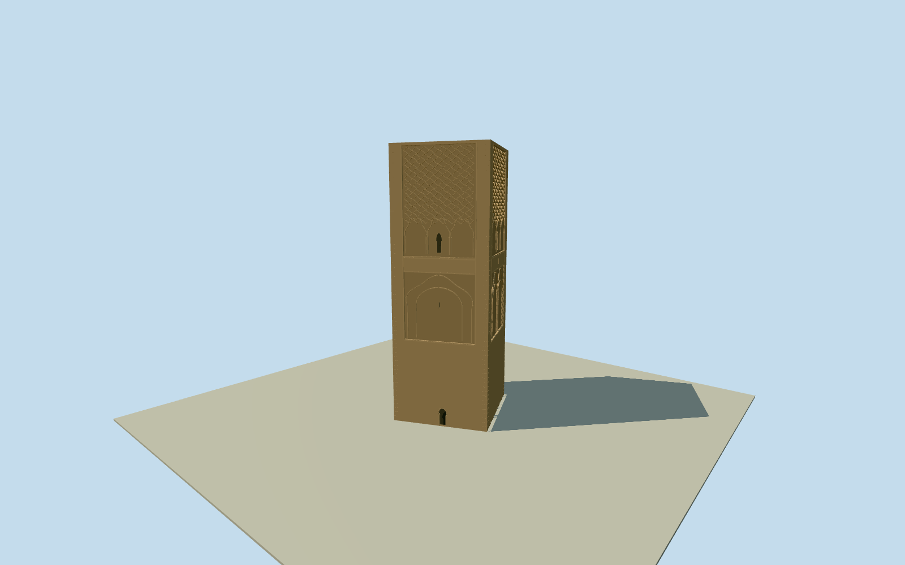

# Hassan Tower

Whole surviving Hassan Tower/Tour Hassan Q579331, full nativeway253426261/nine boundarycontrols,44m ochre sandstone square unfinishedminaret, full four exteriorfaces with cornerpilasters, plainlower mass, recessed horseshoe/lobedarch panels, upper sebka diamond/lobedarch relief, small realarchedopenings and low level uncompletedtop. No inventedcompleted minarettop, roofspires or private rampinterior. Foreground separateunfinishedmosquecolumnfield, modern HassanMosque7150024, MausoleumMohammedV/Q219028, balustrades/gardens/park/landscape excluded; this asset is the complete named minaret. Hiddenfacade ornament andsection/recessdepths bounded originalestimates.

Authoring state: **review-in-qa.json**. Current completion evidence is in [qa.json](qa.json) and the [completion ledger](../../../../qualla-structures/batches/qualla-002.PROGRESS.md).

- [Hassan Tower](https://qualla.com/hassan-tower/)

Actual named44m square unfinishedminaretway253426261/Q579331/allnine unique native boundarycontrols, including three intermediate stations along both sideedges and entrance-taggednode11871966802 on southernedge. Nativeheight44 retained as factualsectionreference. Namedphysicaltower is separate from foregroundunfinishedmosquecolumnfield and modernsouthern HassanMosquerelation7150024, not an instruction to extrude their distinct outlines. HassanII MosqueQ41346/hassan_ii_mosque inCasablanca is unrelated and reserved elsewhere; not this tower.

Original400mfield/16641samples/four rawTerrariumtiles frozen before floor/sections/geometry. Single structural floor-1.2m relative to fixed33.4426m provider datum is an unsurveyed reference chosen after immutablefield acquisition, not terrainfitting. Actual nativeheight44m andwhole ninecontrol15.5m-square footprint retained. Intermediate nativeedge stations remain atplinth/fullwall geometry; four major facade directions interpolate nativeedge deviations rather than replacingthem with a generic box. ClearCC0original supplies long plainlowerbody/cornerpiers, broad blindhorseshoe/lobedarch panels, uppersebka diamondrelief and small openings. Lowerpanel13.9..24.65m/upper27.1..43.55m/.22mphysicalrecess, three lowerarches belowupperdiamondfield, small.48mdeep windowbacks, .42mrecessedunfinishedroofterrace andhiddenface ornamental census are bounded originalphoto estimates. No completedupperlantern/spire/roof, privateinterior, foregroundcolumnfield/modernmosque/mausoleum/parkplate. Sourcegrid/PNG/rawtiles unchanged; precise foundation/threshold/hostcontact unresolved, geographicpreview/replaceFootprintfalse.

Whole surviving44m square unfinishedminaret/allnine nativeboundarycontrols, full fourfacades/nativeedge interpolation, long plainlower masonry/cornerpiers, real recessedblind horseshoe/lobedarch panels, raisedupper sebka diamondnetwork, small actualarchedopening/windowbacks andlevelunfinishedtop/recessedterrace. No fabricatedcompleted upperlantern/spire orprivateinterior.

Exact published CarlosZGZ creatorCC0 original/nativeSHA1matched andpersonallyinspected. No supplementalphotographs/generatedbitmaps/photo textures or copied protectedplan. Anonymoushistoricaldrawing/1921plan unselected; foreground separateunfinishedmosquecolumnfield/modernHassanMosque/mausoleum/park/whitebalustrades excluded.

44m nativeheight andwholemappedfootprint factual. Panelheights/reliefdepths/lobe anddiamondcensus, hiddennorth/west facade ornament andunfinishedterrace section original bounded photoestimates. Detail levels simplify physicalcarving while preserving silhouette/main recessedpanelvocabulary.

Original400m129x129field/16641samples/four rawtiles frozen before floors/geometry. Floor-1.2m relative fixed33.4426m provider datum is unsurveyed structuralreference. Groundgrid/PNG/rawtiles unchanged; exacthostfoundation/threshold contact unresolved, geographicpreview/replaceFootprintfalse. Diagnosticflatground separate; no artificialsiteplate.

Build: `node packages/worldgen/scripts/generate-authored-places.mjs --ids=hassan_tower`. Add `--check` to verify exact regeneration. 41886 triangles; 5 materials; no embedded photographs.
