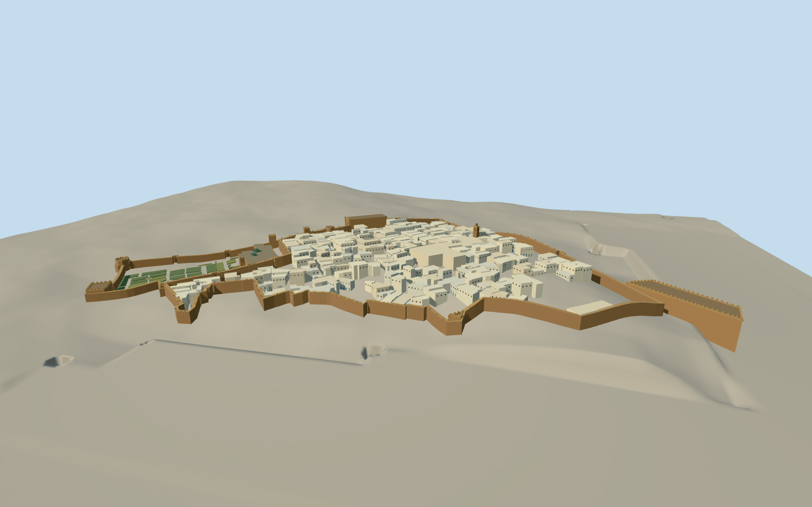

# Kasbah of the Udayas

The Kasbah of the Udayas above the Bou Regreg with Bab Oudaia, the Almohad ramparts, the white-roofed residential quarter, Jami al-Atiq and the Andalusian garden wall.

Authoring state: **review-in-qa.json**. Current completion evidence is in [qa.json](qa.json) and the [completion ledger](../../../../qualla-structures/batches/qualla-003.PROGRESS.md).

- [Kasbah of the Udayas](https://qualla.com/kasbah-of-the-udayas/)

Wall crown and bastion profiles, stair rises, house heights without level tags, roof treatments, and minaret position and height are estimated from the plan and photographs.

The individual residential footprints are retained in the two nearest levels. Nearby outlines are merged at longer ranges.

The field is unchanged, including offshore Terrarium outliers outside the fortified site. The garden beds and fountains follow mapped outlines or positions with schematic heights and plantings. The model omits building interiors.

Build: `node content/worldgen/source/places/ey/ey5/kasbah_of_the_udayas/models/generate-kasbah-of-the-udayas.mjs`. Add `--check` to verify exact regeneration. 29430 triangles; 7 materials; no embedded photographs.
