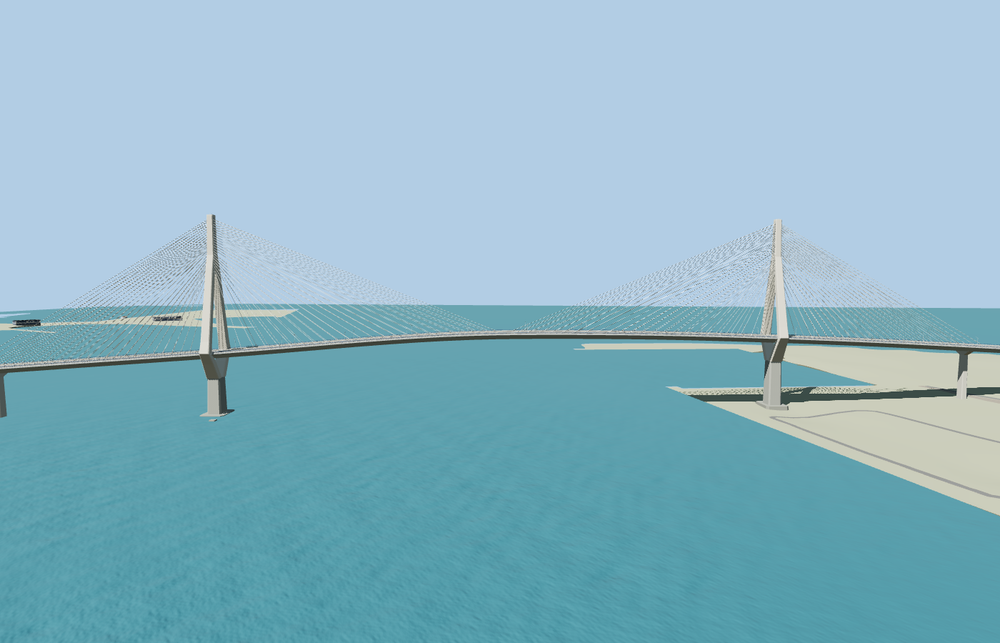

# La Constitución de 1812 Bridge

The 3.09 km Cádiz Bay crossing has two forked concrete towers, four stay fans per tower, the removable deck in place, a shallow steel box girder and both approach viaducts.

The 40,348-triangle source rebuilds byte for byte. Skyline, district, street and close-up use 940, 3,928, 14,652, 35,100 triangles. The first two tiers total 378,024 bytes. Six GLBs validated and 38 current views were inspected.

All four tiers pass 18 landing checks. The largest sampled deck-to-approach difference is 0.054 m. The rendered central span has at least 69.13 m above the viewer water at the central probe. The two independent flyover parts, 494 surrounding buildings, native terrain and water are retained. Failed loading restores 15 mapped crossing parts.

Aerial control and the retained PMTiles footprint determine the alignment. Global elevation controls the abutment contacts and visible foundations. The intermediate vertical alignment and pier spacing are exterior visualization estimates. The removable span is modeled in its installed position. The catalog mesh does not simulate span removal, traffic rules, structural behavior, or vessel navigation. The Puerto Real service roads remain in the native scene. The standard elevation grid does not describe their underpass clearance or detailed abutment grading. Physical-device timings are unmeasured.

Rebuild with `node packages/worldgen/scripts/generate-cadiz-1812-bridge.mjs`. Append `--check` to compare exact bytes. Use `--ids=la_constitucion_de_1812_bridge` for targeted import, LOD, placement and readiness.
