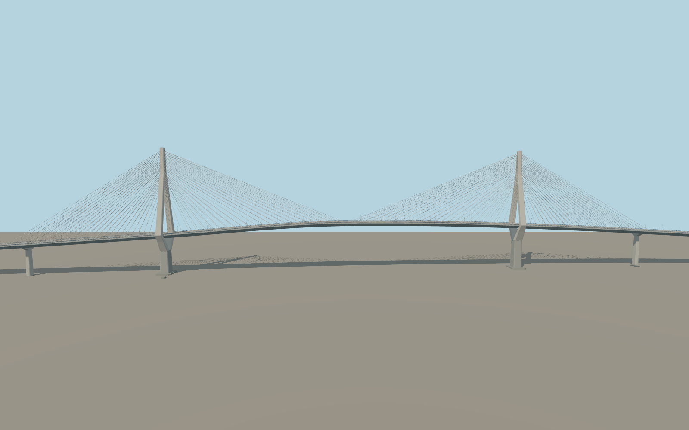

# La Constitución de 1812 Bridge

The 3.09 km Cádiz Bay crossing has two forked concrete towers, four stay fans per tower, the removable deck in place, a shallow steel box girder and both approach viaducts.

Run `node packages/worldgen/scripts/generate-cadiz-1812-bridge.mjs` to rebuild the source master. Append `--check` to compare the exact bytes. Use `--ids=la_constitucion_de_1812_bridge` for targeted import, LOD generation and placement.

Aerial control and the retained PMTiles footprint determine the alignment. Global elevation controls the abutment contacts and visible foundations. The intermediate vertical alignment and pier spacing are exterior visualization estimates.

The removable span is modeled in its installed position. The catalog mesh does not simulate span removal, traffic rules, structural behavior, or vessel navigation.

The Puerto Real service roads remain in the native scene. The standard elevation grid does not describe their underpass clearance or detailed abutment grading.

Original geometry follows the repository license. Map data is © OpenStreetMap contributors under ODbL-1.0 via Protomaps. Terrain samples are described in terrain-grid.json. Ordinary pictures stay local and are not redistributed or used as textures. Current acceptance is recorded in qa.json.
