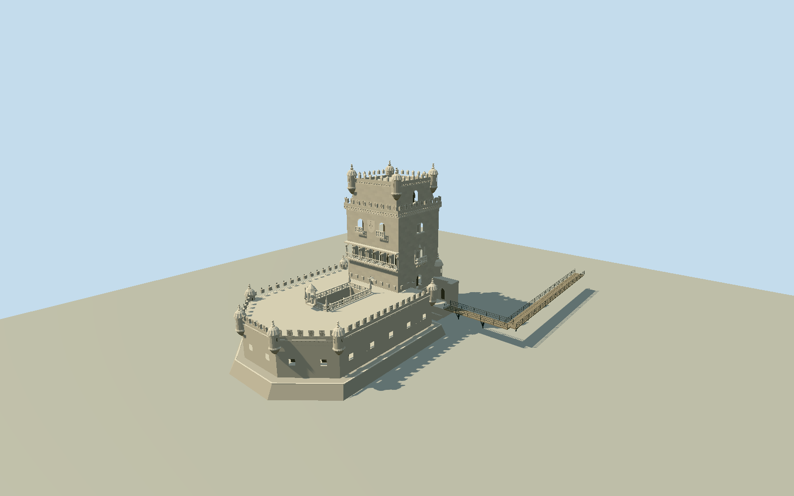

# Belém Tower

Pale Manueline square tower with recessed upper chapel, projecting machicolated roofwalk and Christ-cross shield merlons; fluted domed bartizans and beaded finials. Distinct north paired balconies and seven-arch south river loggia, royal shield and Madonna canopy. Native polygonal river bastion with16 recessed gunports, actual lower open court, pierced quatrefoil rails/pinnacles, tidal foundation and narrow L-shaped elevated steel/wood entrance bridge.

Authoring state: **review-in-qa.json**. Current completion evidence is in [qa.json](qa.json) and the [local 100 ledger](../../../../qualla-structures/batches/PROGRESS.md).

- [Belem Tower](https://qualla.com/belem-tower/)

Native map is quantized; mapped height fields are relative building annotations, not surveyed architectural or tidal elevations.

Current article coordinate is south of the tower body; anchor derived from actual native tower polygon.

Approach bridge is a photo-directed approximate plan; native vector extract does not contain its complete route. No surveyed bridge dimensions or tidal elevations.

Foundation toe flares5.5percent below the native upper foundation edge; north podium and masonry courses follow photographic interpretation. Mapped29m body/30m parapet exclude interpreted bartizan domes/finials, extending to32.7m above provider-water control. Aperture heights, sculpture and ornament are conservative photographic interpretations, not measured drawings.

The bridge L-plan is constrained by the official aerial/entrance photos and mapped east landing; route, structural spans and widths are approximate. Endpoint meets unchanged source shore field. No engineered bridge, interiors, navigable collision or operating tide/water simulation.

Original Terrarium pixels may oversample coarser composite DEM;1m sampling is not survey resolution. Default coarse world terrain is not certified.

Build: `node packages/worldgen/scripts/generate-authored-places.mjs --ids=belem_tower`. Add `--check` to verify exact regeneration. 54259 triangles; 6 materials; no embedded photographs.
