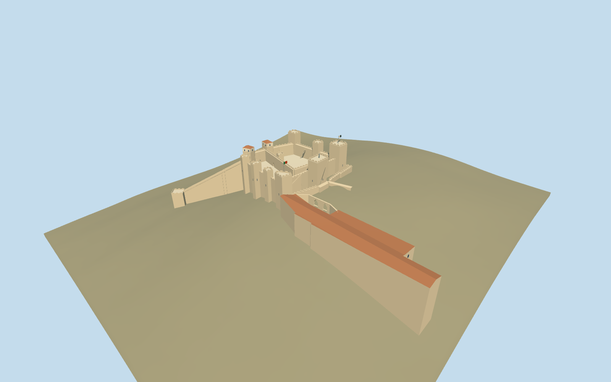

# Castle of Saint George

Current São Jorge fortress: eleven distinct towers, two open courts/divider, two roofed north towers, periscope and flags, real gates/bridges, lower barbican, current museum/palace remains and hillside São Lourenço tower/stair link.

## Evidence and reconstruction

Published dimensions and reconstructed details are separated in spec.json. Primary references:

- [Reference](https://api.openstreetmap.org/api/0.6/map?bbox=-9.1365,38.7116,-9.1302,38.7155)
- [Reference](https://castelodesaojorge.pt/en/castle/national-monument/the-castelo-de-sao-jorge/)
- [Reference](https://castelodesaojorge.pt/en/castle/national-monument/the-royal-palace/)
- [Reference](https://castelodesaojorge.pt/en/castle/national-monument/the-walls/)
- [Reference](https://castelodesaojorge.pt/castelo/mapa-interativo/)
- [Reference](https://castelodesaojorge.pt/wp-content/uploads/2022/08/mapa.jpg)
- [Reference](https://castelodesaojorge.pt/wp-content/uploads/2022/05/%C2%A9SergiyScheblykin_-Torre-de-Ulisses_DJI_0067-1024x682.jpg)
- [Reference](https://castelodesaojorge.pt/wp-content/uploads/2022/05/%C2%A9SergiyScheblykin_-Porta-da-traicao_DJI_0156_1-1024x682.jpg)
- [Reference](https://castelodesaojorge.pt/wp-content/uploads/2022/05/%C2%A9SergiyScheblykin_-Torre-da-cisterna_DJI_0132_1-1024x682.jpg)
- [Reference](https://castelodesaojorge.pt/wp-content/uploads/2022/05/%C2%A9Kenton.Thatcher_Barbaca-e-fosso_DSC8444_445_BW_1_FIN-e1655515600973-1024x683.jpg)
- [Reference](https://castelodesaojorge.pt/wp-content/uploads/2022/05/%C2%A9Sergiy.Scheblykin_Muralhas_DJI_0050-e1655516822529-1024x683.jpg)
- [Reference](https://castelodesaojorge.pt/wp-content/uploads/2022/05/%C2%A9Americo.Simas_Paco-Real_-pan-03.jpg)

Five existing shared256-square limestone, ceramic tile, painted metal, timber and gravel graphs; metric repeats, linear tint. Glass/flags remain flat. No new or embedded texture or copied mesh.

## Model and axes

6,923 triangles; 20,769 vertices; 7 material groups; 834,836 bytes. Native bounds: -74.554, -28.054, -79.530 to 43.949, 37.000, 145.569. Source hash: `sha256:502d5cfe8223e0c2732001af078cfc99103d62bc3037202f75c16b4a0c5ff44b`.

{"up":"+Y","longitudinal":"Native+X east,+Z south, heading0; original footprint and gateway coordinates preserved.","origin":"Site anchor; Y0 standard PMTiles working datum."}

The inspected aerial picture supports the crenellated fortress with rectangular towers, open courts, roofed north towers and long walled hillside stair to the lower tower. Retained map controls set approximate plan scale and heading0. Standard viewer PMTiles supply the hill. The main court is reconstructed8m above the anchor datum; bounded outer wall and museum footings reach sampled terrain. The lower tower preserves its13m exterior height on its own PMTiles floor; its stair and walled link meet that tower and the main wall walk. Anchor -9.133459014,38.713919369; heading 0; standard PMTiles datum 89.69677216774184m. Floors are reconstructed and foundations extend below the coarse sampled ground.

## Reproduce

Run `node packages/worldgen/scripts/generate-signature-towers.mjs --ids=castle_of_saint_george` (or add `--check`). The generator preserves manually edited masters by checking their baseline hashes. Import through the standard authored-model workflow with optimization disabled; then capture all QA cameras, including shared-surface views.

## Pending work

- Approximate exterior and hill fit from the inspected picture and standard viewer PMTiles; no bespoke survey or exact court/observatory altitude claims.
- Original detailed master/hash/recipe preserved. Eleven fortress towers, two courts, gateways, bridges, current museum and lower hillside tower/link remain distinct; restoration fixtures and masonry details are interpreted.
- Five common limestone/tile/painted-metal/wood/aggregate graphs plus explicit glass and flag colors; no embedded images or broad duplicate natural hill.
- Interiors, collision and physical-device timing excluded; footprint replacement remains off.

This bundle follows the medium-fi standard. Medium-fi appearance and geographic fit are reviewed separately. Hash-bound visual acceptance is recorded separately after capture inspection.

## Additional geographic data

© OpenStreetMap contributors; Castelo de São Jorge and its credited photographers. Preview terrain: Mapzen Terrain Tiles and source contributors; independent public height query: Direção-Geral do Território.
