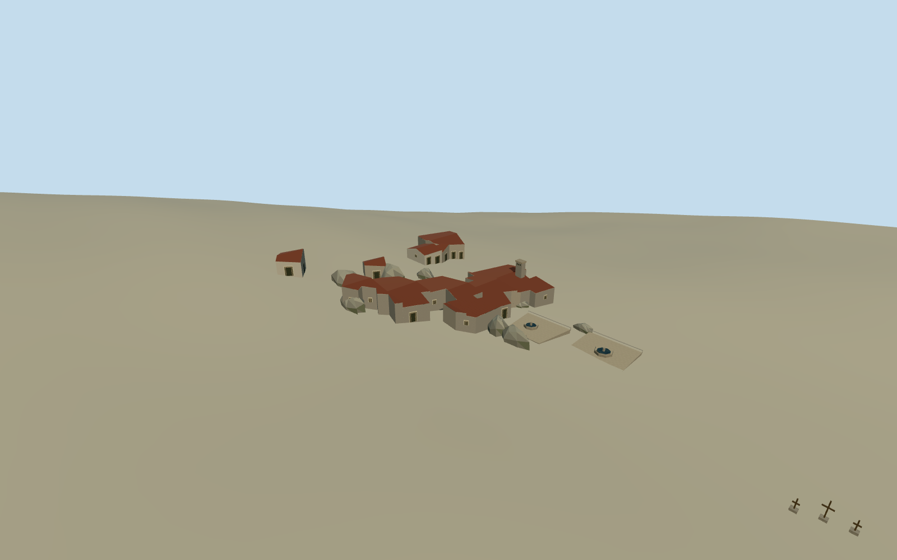

# Convent of the Capuchos (Sintra)

Sintra’s Convent of the Capuchos, with small tiled rooms built around granite outcrops, stone chapels and the fountain approach.

Authoring state: **review-in-qa.json**. Current completion evidence is in [qa.json](qa.json) and the [completion ledger](../../../../qualla-structures/batches/qualla-003.PROGRESS.md).

- [Convent of the Capuchos (Sintra)](https://qualla.com/convent-of-the-capuchos-sintra/)

Roof subdivisions, retaining stone sizes, doors and hermitage heights are approximate. The exterior layout follows the named mapped buildings.

Cloister furnishing positions, granite boulders and the main entry steps are reconstructed from oblique photographs and the terrain. The small rooms are modeled from their visible exterior.

Build: `node content/worldgen/source/places/ey/eyc/convent_of_the_capuchos_sintra/models/generate-convent-of-the-capuchos-sintra.mjs`. Add `--check` to verify exact regeneration. 1683 triangles; 6 materials; no embedded photographs.
