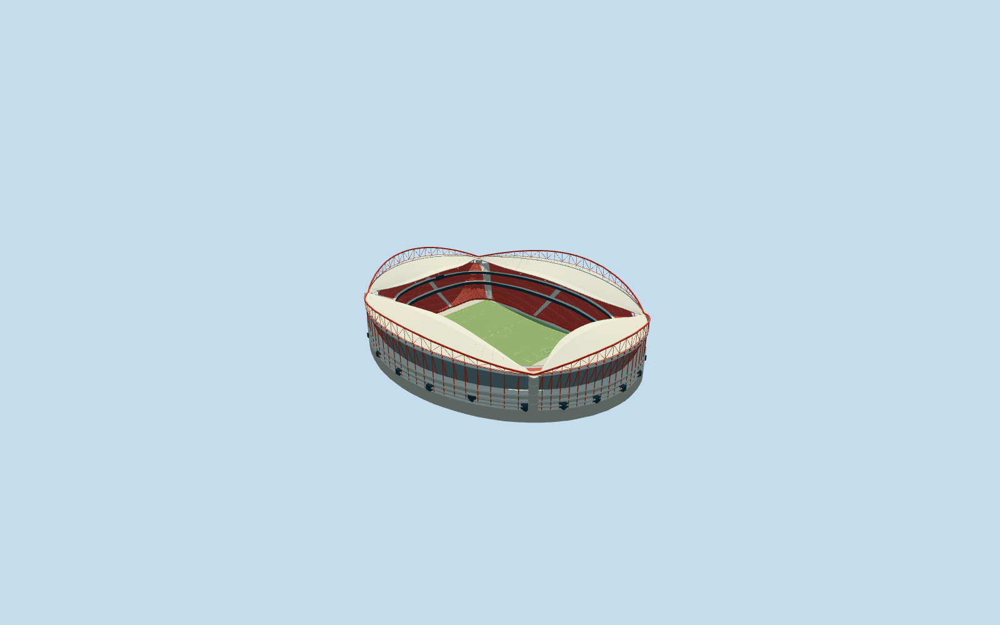
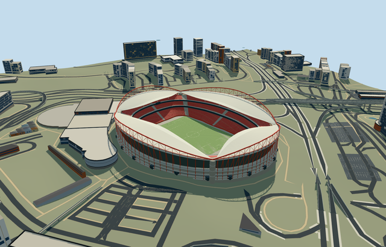

# estadio_da_luz — Estádio da Luz

Reviewed 2026-10-20 in one continuous author/build/inspect/fix round.

## Appearance

Inspected48 current portable/shared/medium-fi/native-Lisbon frames in one ordinary-picture/PMTiles/build/inspect/fix pass, including full-size native red arch/core/raker frontage and bowl/underside views. Specific own oval shell/scalloped four-sided aperture, four connected red tubular bow arches/webbing/pale closed wave roof/renderable underside/radial lattice, four pale corner support-core approximations, three red seating bands/two closed dark box belts/open neutral football floor, grey louver upper facade/sloped red rakers/curved pale balcony rim, lower concrete/glazed service-concourse frontage and supported neutral displays/lights/goals are present. No missing side or original duplicate stadium shell. Corrected arch/core/roof contacts and native sub10cm opening-return mask residue. Individual red seats merge into terrace patches; no copied lettering/emblems/event artwork. Portable/synthetic flat ground is separate from native grade; native low frontage vantage has foreground bank occlusion, not missing model geometry.

## Shared materials and browser levels

Five existing256-square graphs: concrete_plain, metal_painted, metal_corrugated, window_grid and fabric_canvas. Concrete supports lower structure/decks/cores/footings; tinted paint supplies red tubular arches/webbing/rakers/tiers and pale trim/marks/screens; shared corrugated metal approximates grey upper facade louvers, window-grid closed lower glazing, canvas opaque pale roof/turf grain. Six near draws because roof and turf use different slots of the same graph; zero embedded images/unique atlas/copied photo pixels. Each nearby shared graph read once; metric repeats/linear tints and separate POSITION/NORMAL uploads/equal reported CPU/GPU geometry bytes verified. Corrugation/glazing/roof opacity are explicit shared approximations, not exact louver construction/translucent polycarbonate or optical simulation.

| Level | Triangles | Bytes | Draws |
| --- | ---: | ---: | ---: |
| skyline | 728 | 71352 | 1 |
| district | 3818 | 368316 | 6 |
| street | 14886 | 1419556 | 6 |
| closeup | 54374 | 5359376 | 6 |

Inspected24 current noon/late Economy/High street/block/skyline/silhouette/matched-level/transition frames. All levels retain own oval envelope/open field/scalloped roof/four red arch silhouettes/three red tiers and correct internal field direction. Near levels refine arches/webbing, curved tier treads/aisles/concourse belts/rakers/cores/roof ribs; far levels coarsen repetitions and omit fine subpixel webs. Initial skyline plus district439668bytes, below3MB phone/6MB laptop targets. Synthetic context is not geographic evidence. Physical ordinary-laptop/phone/dense-city timings remain pending. Levels728/3818/14886/54374 triangles; at most six draws.

## Approximate map fit

Exact-QID retained OSMrelation9143921 identifies existing Estádio da Luz. Native52776567277169 supplies approximately250x205m oval body/132.032722x87.797227m central field surround; same-stadium52776574483134 supplies matching-hole stand/scalloped four-sided outer boundary used as approximate canopy-aperture control. Own anchor[-9.18468878324619,38.75268951747744]/heading0/native east-south; internal X[.26593139404384153,.9639919572599654]/Z[-.9639919572599654,.26593139404384153] follows actual field opening rather than undirected outer ellipse. Neutral105x68m field is not stretched to roof size. Both owned stadium records completely removed, zero remaining records/area.50mm corner guards cover a native sub10cm hole return; adaptive overlapping decomposition seams stay inside owned mask. All292 independent resident inputs of294 originals/630 wider records, original6m samples/native roads/1224.475156419101m2 source water remain unchanged; all628 wider independent footprints disjoint from mask. Individual facade/core contacts/occupied floor and bounded opening within90percent body/common floor handle coarse elevation without original-sample/outside/water edits or whole neighborhood/plaza slab. Failure retains294 originals/original ground; every level unloads with restored ground/water/zero live geometry. Coarse native foreground bank occludes part of low frontage vantage; synthetic flat ground does not reproduce the original slope.

## Limits

Four ordinary Commons photographs actually viewed: Massimo Catarinella2009-07-30 interior panorama(CC BY3.0), Trickstar2007-04-27 exterior(CC BY-SA3.0), Vitor Oliveira2005-12-17 exterior(CC BY-SA2.0), F nando2010-07-19 seating detail(CC BY-SA3.0). Viewed only; no photograph pixels/club emblems/advertisements/seat lettering copied. Existing mapped stadium modeled; old demolished predecessor and proposed Benfica District redevelopment are excluded. Native43m height has unqualified datum; working red arch maximum43m/feet27.5m, outer roof27.5..33.5m/inner26.1..32.1m, core tops27.25m, tiers1.4..10/13..17.5/20..22.7..29m, facade rim26..30m and concrete bands3/7/11.7m are picture-led allocations. Four3.4m-radius core positions/0.62m arch-tube radius/row/web/raker/portal inventories and20degree/2m fine facing are approximate. Shared opaque canvas/corrugation/glazing do not reproduce optical transmission/exact panel/louver/seat inventory. No engineering/access certification, hidden furnished circulation or later/current-condition/redevelopment-completion claim. Original anchor DEM91.98627931703568m/local contacts/bounded opening address coarse terrain, not surveyed excavation or site grading; coarse low-frontage foreground bank can obscure lower facade. Native museum/arena/other Lisbon blocks/roads/water stay separate. Physical ordinary-laptop/phone/dense-city timings remain pending.

## Selected checks

Six Khronos files: zero errors/warnings.8544 actual mesh/material/contact checks; 48 current inspected views. Scene validation/sim30 and strict selected medium-fi audit pass. Source/runtime/LOD hashes and material bindings verified.

Rebuild: node packages/worldgen/scripts/generate-additional-landmarks.mjs --ids=estadio_da_luz; node packages/worldgen/scripts/import-structure-models.mjs --ids=estadio_da_luz; node packages/tooling/scripts/generate-landmark-lods.mjs --ids=estadio_da_luz --force.

Source: sha256:5ea66e9cbd99631baf075e8390b1f0527f28352c42711561fbb005cc42dee08e

Runtime: sha256:b78aa85cdbf5cb9362ccbf4c4d1c563244a6c3a2660daa8926e5365d51516aef

Input: sha256:7059b3dec4884563fdda84ee01dc6b3781bcc790e5f153c6386c7bcbb10e0d92

## Viewed ordinary pictures

https://commons.wikimedia.org/wiki/File:LuzLissabon.jpg — LuzLissabon.jpg, expanded960x350; Massimo Catarinella; CC BY3.0 Unported; viewed only/no photograph pixels copied. Viewed only; no pixels copied.

https://commons.wikimedia.org/wiki/File:S7000272_2.JPG — S7000272_2.JPG, expanded960x586; Trickstar; CC BY-SA3.0 Unported; viewed only/no pixels copied. Viewed only; no pixels copied.

https://commons.wikimedia.org/wiki/File:Est%C3%A1dio_da_Luz_-_Lisboa2.jpg — Estadio da Luz - Lisboa2, expanded960x720; Vitor Oliveira; CC BY-SA2.0 Generic; viewed only/no pixels copied. Viewed only; no pixels copied.

https://commons.wikimedia.org/wiki/File:Est%C3%A1dio_do_Benfica_(pormenor).jpg — Estadio do Benfica pormenor, expanded960x720; F nando; CC BY-SA3.0 Unported; viewed only/no pixels copied. Viewed only; no pixels copied.
