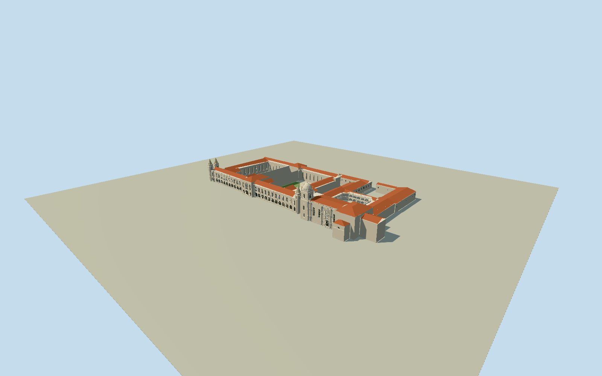

# Jerónimos Monastery

Native connected monastery ensemble with integral west dormitory/museum facade, eleven normal bays each side of a central three-bay pavilion, recessed lower arcade glazing, tall upper windows and pitched terracotta roofs. Four slender crocketed dormitory turrets in front/rear end pairs and a separate broad stone-domed church campanile. True open two-storey chamfered cloister, triple lower shafts/paired upper lights, medallion parapets and conical pinnacles; lawn, paths and low circular fountain. Church Latin-cross mass, giant pointed south windows, projecting tiered sculptural south portal, pierced roof rail, distinct rear/chancel roofs, attached northern monastic rooms and separate large western court.

Authoring state: **review-in-qa.json**. Current completion evidence is in [qa.json](qa.json) and the [local 100 ledger](../../../../qualla-structures/batches/PROGRESS.md).

- [Jerónimos Monastery](https://qualla.com/jeronimos-monastery/)

Native plan is quantized; roof/tower heights and individual carved details are not measured by this footprint data.

Long western dormitory facade is integral to the monastery ensemble despite current museum use; detached modern museum/planetarium halls remain separate.

Original terrain field must remain unchanged. Native roof/tower data are incomplete; photographic estimates need separate geometry and geographic review.

All vertical dimensions, roof pitches and facade positions within native plan limits are photographic interpretations, not measured drawings. Fine statuary, inscriptions and dense carved foliage are generalized.

Principal cloister galleries have real openings; interior monastic rooms and exhibitions are not represented. No navigable collision or survey-quality archaeological/architectural reconstruction.

Two source terrain PNGs/263169derived heights remain unchanged. Composite urban DEM may include roofs or vegetation;1m sample spacing is not survey accuracy and default coarse terrain is not automatically certified.

Build: `node packages/worldgen/scripts/generate-authored-places.mjs --ids=jeronimos_monastery`. Add `--check` to verify exact regeneration. 62711 triangles; 6 materials; no embedded photographs.
