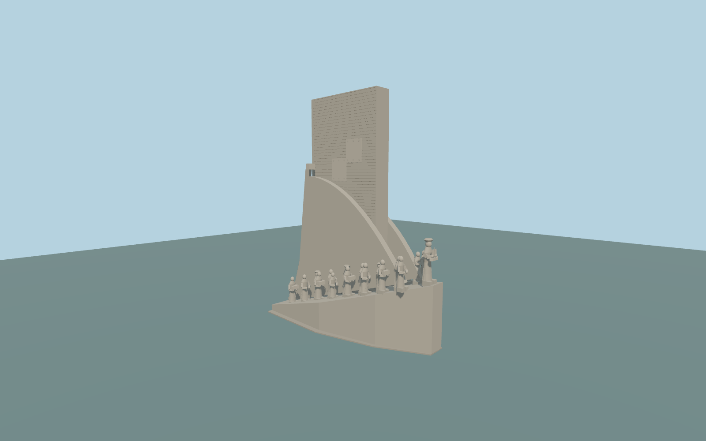

# Padrão dos Descobrimentos

Complete principal Padrão dos Descobrimentos exterior:closed irregular stepped base andrising tapered ship-bow hull,52m rectangular sail/mast,two thick curved sail cheeks,narrow rear sword/cross face andflared buttresses,closed deeply recessed arched rear door withnine steps,and33 original stone figure interpretations inascending two-sided groups witha larger leading figure,robes/heads/arms/hats/books andgeometric relief panels. Independent armillary spheres/plinths,compass paving,plaza,quay,waterfront andneighbors remain native. Original abstract sculpture proportions,not copied portraits,inscriptions orauthentic individual likenesses;navigable interior excluded.

Rebuild: `node packages/worldgen/scripts/generate-padrao-dos-descobrimentos.mjs`;append `--check` for exact source bytes. Select import/LOD/placement with `--ids=padrao_dos_descobrimentos`. Detailed source and four browser tiers are separate ignored GLB outputs.

Complete principal Padrão dos Descobrimentos exterior:closed irregular stepped base andrising tapered ship-bow hull,52m rectangular sail/mast,two thick curved sail cheeks,narrow rear sword/cross face andflared buttresses,closed deeply recessed arched rear door withnine steps,and33 original stone figure interpretations inascending two-sided groups witha larger leading figure,robes/heads/arms/hats/books andgeometric relief panels. Independent armillary spheres/plinths,compass paving,plaza,quay,waterfront andneighbors remain native. Original abstract sculpture proportions,not copied portraits,inscriptions orauthentic individual likenesses;navigable interior excluded.

Retained52m andcurrent52m upper part agree. Current parent44.745by20.082m plan andthe thin4m-by20.3m high part guide theenvelope. Hull rake,curved sail profiles,stair/door depths,33 original abstract figure poses,approximate7m side figures/9m leader andgeometric ornament areordinary-picture proportions. Y=0 usesone standard field sample at the rear stair toe[0,-24],5.113334m;center6.435272m hasurban returns. Principal base+.2m andclosed support-6m;exact quay/paving/steps arenot surveyed.

Onlytwo ordinary whole-monument pictures,current standard PMTiles andtwo unchanged global Terrarium tiles. Original abstract33-figure group preserves recognizable density/poses butnot individual identities,portrait likeness,historical costume accuracy orcopied reliefs/inscriptions. Hidden inventory andfine stone courses areapproximate. Independent armillary spheres/compass paving/quay remain outside principal scope. Numerical LOD error andphysical-device timing unmeasured.

Three existing shared256px raw limestone,granite andplain wood graphs in three used groups;metric UVs,linear colors,no embedded/private images. Skyline uses13 closed figure proxies whilepreserving thecomplete principal silhouette,closed hull/curved cheeks/mast/rear door andcoarse3-step flight. District has33 simplified figures andnine steps;street/closeup/master add arms,original faces/robe folds/feet,geometric panels andstone courses. Source separately retains32-segment figure curves and96-segment sails.

Original geometry:repository license. Map:© OpenStreetMap contributors,ODbL-1.0;Protomaps. Standard terrain:terrain-grid.json. Ordinary pictures stay local and are not redistributed or used as textures. Current acceptance:qa.json.
