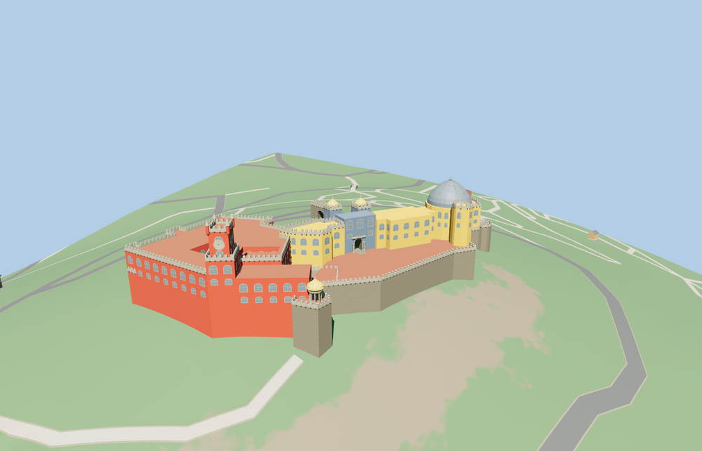

# Pena Palace

The red convent and corner-pinnacled clock tower stand beside the ochre palace and its lead-colored dome. An open stone gate leads toward twin gilded cupolas above the tiled portal. The vaulted passage links the entrance side with a paved terrace and an open domed lookout.

The 57,352-triangle source rebuilds byte for byte. Skyline, district, street and close-up use 951, 3,114, 15,424, 56,800 triangles. Skyline and district total 349,128 bytes. Six GLBs validated and 36 current views were inspected.

All four tiers pass four roof crest, seven floor and six opening probes. Both cloister courts and the domed lookout remain open. The retaining base follows 20 terrain samples around the visitor terrace. The viewer retains 7 independent buildings and 90 transportation records. Failed loading retains the 23 mapped palace records.

The original and newer wings follow the PMTiles component outlines. Parapets, tower heights, roof profiles, and the entrance carvings are photo-based estimates. Hilltop walls use the standard terrain grid, whose source resolution approximates the exposed rock and terrace elevations. The visitor terrace, gate threshold and connecting grades are inferred for exterior visualization. Interior rooms and exact stair dimensions are outside the model.

Rebuild with `node packages/worldgen/scripts/generate-pena-palace.mjs`. Append `--check` to compare exact bytes. Use `--ids=pena_palace` for targeted import, LOD, placement and readiness.
