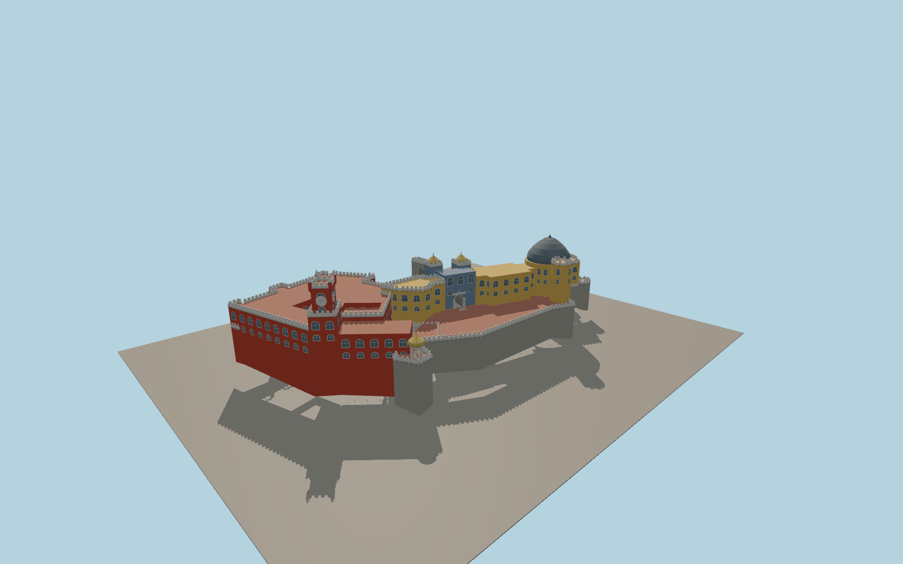

# Pena Palace

The red convent and corner-pinnacled clock tower stand beside the ochre palace and its lead-colored dome. An open stone gate leads toward twin gilded cupolas above the tiled portal. The vaulted passage links the entrance side with a paved terrace and an open domed lookout.

Run `node packages/worldgen/scripts/generate-murcia-cathedral.mjs` to rebuild the source master. Append `--check` to compare the exact bytes. Use `--ids=pena_palace` for targeted import, LOD generation and placement.

The original and newer wings follow the PMTiles component outlines. Parapets, tower heights, roof profiles, and the entrance carvings are photo-based estimates.

Hilltop walls use the standard terrain grid, whose source resolution approximates the exposed rock and terrace elevations.

The visitor terrace, gate threshold and connecting grades are inferred for exterior visualization. Interior rooms and exact stair dimensions are outside the model.

Original geometry follows the repository license. Map data is © OpenStreetMap contributors under ODbL-1.0 via Protomaps. Terrain samples are described in terrain-grid.json. Ordinary pictures stay local and are not redistributed or used as textures. Current acceptance is recorded in qa.json.
