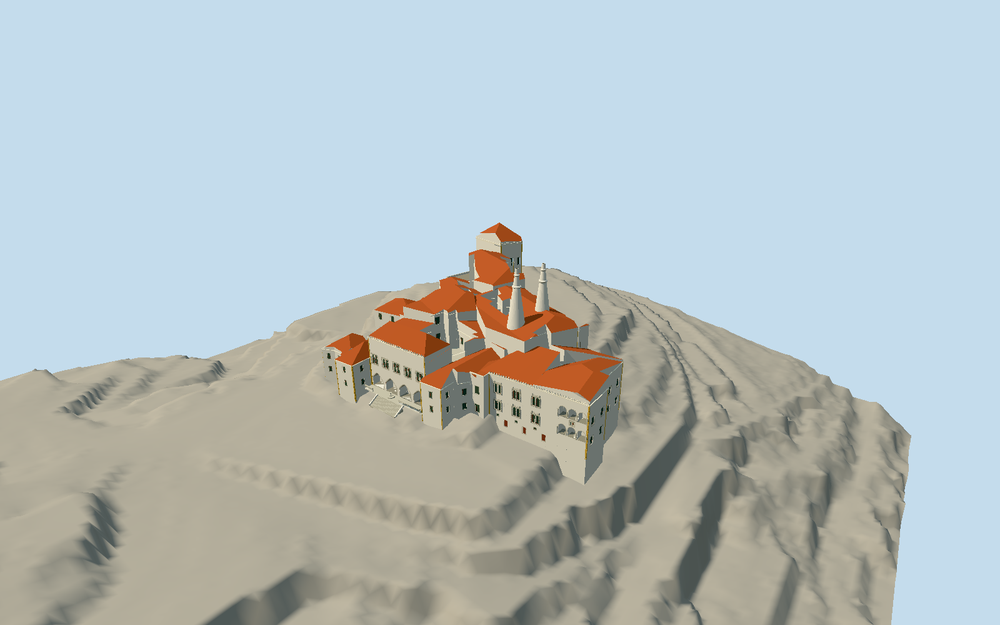

# Sintra National Palace

Native irregular palace ranges and four open courts/lightwells, two33m kitchen-floor-to-top open-mouthed white conical chimneys, tall northwest Coats-of-Arms tower with hipped red roof and stone fret cornice, stepped upper royal ranges and kitchen. Southeast main hall has four real pointed exterior arcade recesses, five deep paired cusp-headed upper window groups, serrated pale parapet, raised stone landing, broad13-tread stair, balustrades and two-tier fountain. Lower front flanking masses and porch connection, eastern Manueline wing with six original abstract carved paired window groups and two three-arch open loggias, low basement lights/doors, yellow corner bands and red tiled roofs. Separate native western entry range, own retaining/terrace walls and Patim porch/straight stair. Town buildings, interiors, literal heraldry, temporary works and vegetation excluded.

Authoring state: **review-in-qa.json**. Current completion evidence is in [qa.json](qa.json) and the [local 100 ledger](../../../../qualla-structures/batches/PROGRESS.md).

- [Sintra National Palace](https://qualla.com/sintra-national-palace/)

No source model, runtime asset, final map frame, heightfield, placement proposal, QA approval or story completion annotation has been created for this target. Counts remain73 ready/79 authored/79 started.

Operator33m height is kitchen floor to chimney top; all other vertical dimensions must be explicit proportional estimates.

Dated exterior finish/roof/threshold details differ across references; current2026 chapel conservation is not reflected in2015/2019 images.

Owner page9 is a visitor illustration; no claim of measured construction drawings. Independent ground must precede geometry.

Native main building has six inner rings: four actual mapped open courts/lightwells and two circular kitchen chimney boundaries. The latter are occupied by modeled chimneys, not extra courtyards. Scope also retains the separate native western terrace entry range, southwest front-flanking mass, northeast porch connection and own retaining/terrace structure; town buildings are excluded.

Actual aerial/owner overview place the four pointed main front spans on the southeast-facing native edge14→13. The west outline is not the main arcade. +X follows this facade toward the Manueline wing; +Z faces the exterior forecourt. Cartographic simplification and dated photos limit precision.

Official July2024 DGT classified LiDAR point observations constrain roof and terrace levels separately from class2 terrain. Class6 returns are not ground; palace-floor levels inferred from class6 surface distributions are dimensional observations, not a surveyed plan. Chimney33m is measured from kitchen floor to top.

Independent public class2 ground is frozen before geometry. There are no class2 returns under most palace roofs/courts: fixed inverse-distance interpolation across these gaps is an independent terrain approximation, not measured subterranean ground. No fitting, flattening or editing to match the building; compatible host terrain is required and default coarse Earth terrain is not certified.

Dated local2011–2019 photos and public2024 LiDAR describe permanent exterior features; current2026 chapel restoration finish not asserted. Intermediate roof ridges/eaves, unknown back-face bay counts, carved details, terraces, Patim/stair placement and construction thresholds are interpretations. Four front arches are exterior recesses with back walls, not four through-gateways. Original abstract carving/geometry replaces exact heraldry/inscriptions. This model remains in review until current geometry, all detail levels, terrain/placement and actual renders pass.

Build: `node packages/worldgen/scripts/generate-authored-places.mjs --ids=sintra_national_palace`. Add `--check` to verify exact regeneration. 27630 triangles; 7 materials; no embedded photographs.
