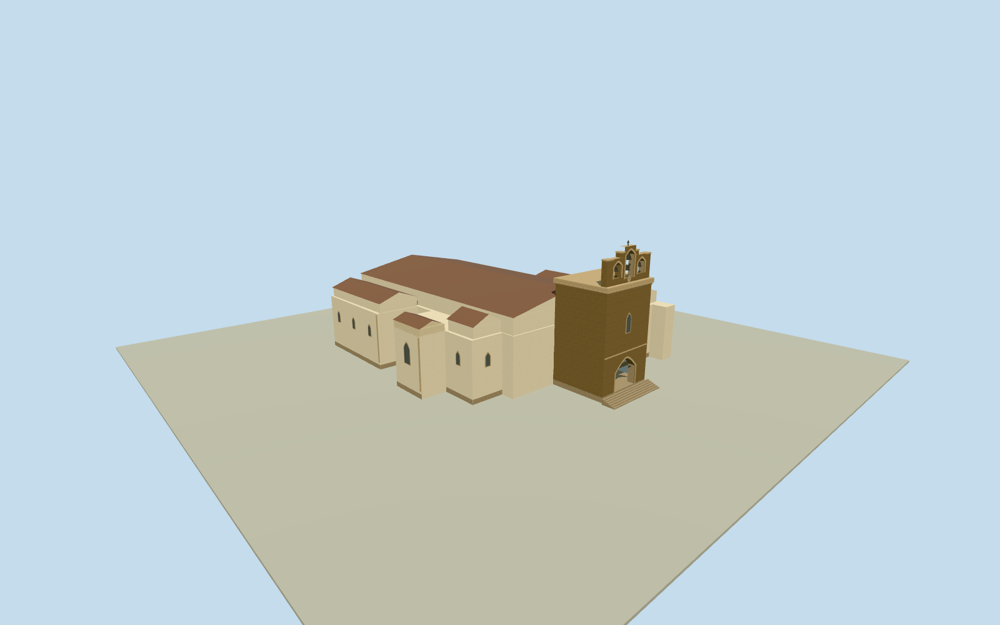

# Faro Cathedral

White Faro Cathedral ranges and the stone bell tower with a double Gothic porch and three open bell bays.

Authoring state: **review-in-qa.json**. Current completion evidence is in [qa.json](qa.json) and the [completion ledger](../../../../qualla-structures/batches/qualla-003.PROGRESS.md).

- [Faro Cathedral](https://qualla.com/faro-cathedral/)

The exterior represents July 2014. Bell sizes, carved ornament, masonry courses and elevations obscured in the accepted photos are approximate.

The source elevation field is preserved without flattening. Entrance tread and threshold dimensions are representative.

The neighboring garden, detached São Miguel Chapel and cathedral interiors are outside the model.

Build: `node content/worldgen/source/places/ey/eyd/faro_cathedral/models/generate-cathedral.mjs`. Add `--check` to verify exact regeneration. 2333 triangles; 6 materials; no embedded photographs.
