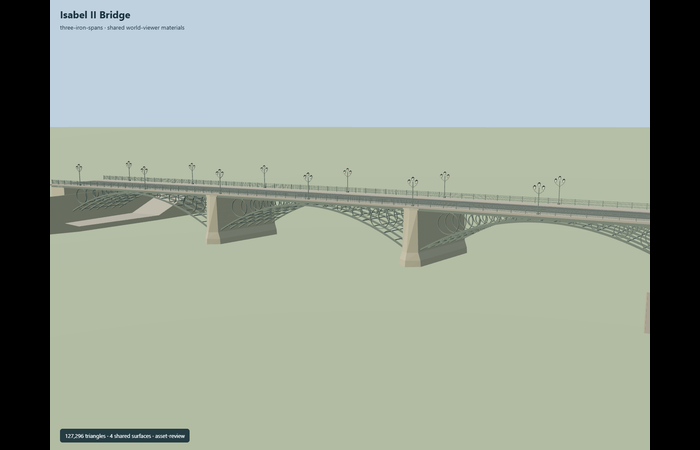
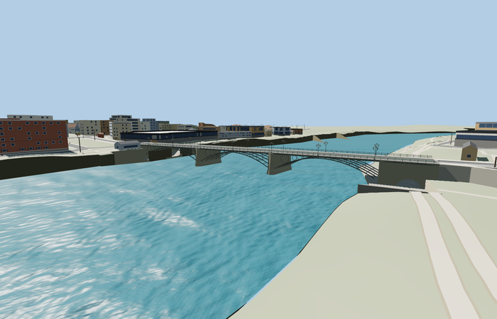

# Isabel II Bridge

Reviewed2026-10-29. **Complete medium-fi static exterior and approximate native placement.**

Inspected69 current frames:11 portable,10 shared-material stage,27 medium-fi/context/LOD and21 native PMTiles views. Three open iron spans, hollow graduated circular spandrels, seven arch ribs in the master, skew cutwater piers, continuous crowned roadway and raised sidewalks, rails and three-light lamps are complete. Ordinary photographs corrected the draft western masonry tunnel to a solid bank abutment with riverwalk beneath the iron arch. The eastern masonry passage is separately modeled. Lower-quay aprons,transition ramps and landward retaining faces provide bounded coarse-terrain integration. Distance tiers aggregate circles, ribs, lamps and guards while retaining three open spans and bank passages.

Four existing shared256px graphs: metal_painted for ironwork,stone_limestone_raw for masonry,concrete_plain for roadway and stone_granite for sidewalks/quay paving; a fifth local marking material. Metric UV repeats and linear sRGB-derived vertex tints; no private or embedded images. Concrete grain approximates roadway. The graphs load once and model/support geometry disposes. Source/local contextY0 differs from the separately reviewed native water origin.

| Level | Triangles | Bytes | Draws |
| --- | ---: | ---: | ---: |
| skyline | 940 | 77300 | 1 |
| district | 3914 | 322236 | 5 |
| street | 14824 | 1242040 | 5 |
| closeup | 41172 | 3528496 | 5 |

Detailed source 127296 triangles,15278780bytes. Browser triangles 940 / 3914 / 14824 / 41172, bytes 77300 / 322236 / 1242040 / 3528496, draws 1 / 5 / 5 / 5. Initial skyline+district 399536bytes. All levels meet1000/4000/16000/64000triangles and at most5draws,with separate GPU position/normal streams. Original master retains all seven arch ribs and circles; browser tiers retain three open spans,continuous road/sidewalks and two bank passages. No physical device timing claim.

Exact-QID way236420470 supplies the165.001m by16.319m footprint; published149m catalog length remains a distinct record. Current PMTiles main road35184400206486 and distinct cycleway35184501130790/sidewalk35185072157600 establish fit. Anchor[-6.00238785,37.386326592],heading0.960148794974: +X northeast/old Seville,-X southwest/Triana,+Z southeast/downstream toward Torre del Oro,-Z northwest/upstream. Native origin0.9201589226722717m follows the standard viewer water plane. Pier stations, reconstructed unequal bank spans, skew, circular spandrel radii, member sections and vertical grades are photo/map approximations.

All five loaded tiers preserve209 building records,150 independent road records,the original165 raw road inputs,rawDEM,water and sampled terrain outside two bounded quay corridors. Five overhead crossing records are replaced (165to160);30 road/cycleway/sidewalk width probes have actual model paving,maximum gap0.006001m. Two source-authored quay aprons/ramps and retaining faces replace coarse bank ground and cap mapped paving inside their explicit outlines. Lower map lines remain; connected approach-grade metadata can propagate along the surrounding path network outside these caps. The four unrelated mapped tunnels retain their inputs and have no authored bridge joins. Source/runtime rays verify both lower-quay paving and at least1.95m geometric headroom at six central passage samples; this is a scoped visualization check,not an accessibility certification. Failed loading retains all165 roads and original ground. Unloading restores native ground and releases all model/support geometry. Coarse bank grades,steep outer transitions,generic neighbors and omitted quay furniture remain explicit approximations.

## Reconstruction limits

- Original static medium-fi reconstruction from ordinary pictures and current PMTiles. Exact-QID footprint is165.001m by16.319m, distinct from the149m catalog length; these records are not conflated. Pier stations, unequal reconstructed bank spans, skew, iron sections, circle radii, lamps and all vertical profiles are visualization controls, not engineering measurements.
- Three open iron spans, hollow graduated circular spandrels, stone cutwaters and pier caps, complete crowned roadway, both raised sidewalks, railings, three-light lamps, solid western abutment and eastern masonry passage are modeled. Close-up tier aggregates internal circles while preserving exterior ones; detailed master retains all seven ribs and their circles.
- Current mapped lower quay routes and water boundaries bound two source-authored paving aprons, transition ramps and landward retaining faces. Coarse native ground would otherwise block the passages. The bounded ground/paving cutout retains raw DEM, water, outside terrain and unrelated map records. Quay floor, steep outer transitions and retaining heights are approximate, not a surveyed reconstruction or accessibility claim.
- Adjacent chapel, restaurant, historic riverside buildings, stairways, street furniture and other unique structures remain outside this bridge asset. Generic neighboring buildings and coarse bank grades remain visible. Lower-quay safety railings and temporary street details are simplified/omitted.
- Four existing shared256px graphs: painted metal, raw limestone, concrete and granite paving, with metric UVs and linear vertex tints; a fifth local marking material. No private or embedded images. Concrete grain approximates roadway. Physical laptop/phone timing remains unmeasured.
- Native-fit.json and integration-review.json retain generation controls; current hash-bound acceptance is in qa.json and placement-report.json. Current map semantics and three ordinary photographs establish this static exterior, not engineering dimensions, current traffic legality or accessibility certification. Adjacent unique buildings, quays, modern bridges and their present-day structural condition are outside this model scope. Physical laptop/phone timings remain unmeasured.
