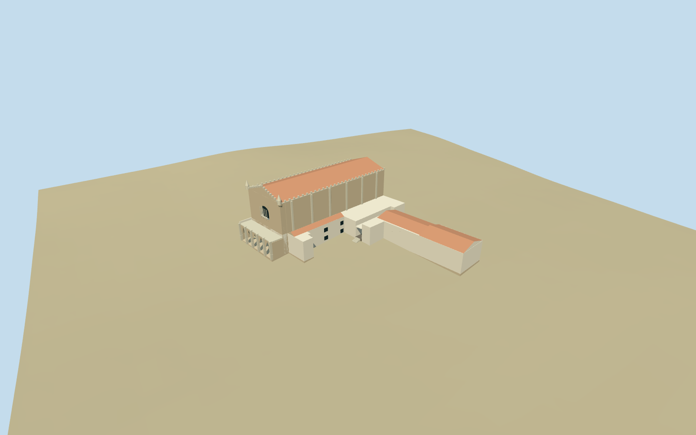

# Capela dos Ossos

Specific Capela dos Ossos interior and connected São Francisco exterior envelope: traversable entry vestibule/stone portal, three-aisle hall with eight bone-covered piers, pale groin vaults/ribs and original simplified ceiling scrolls, dense original skull/long-bone wall vocabulary, high side openings, dark/pale banded floor and simplified gilded twisted-column altar/cross. Host includes mapped stone nave/pointed west portico, crenellated gable/parapets and conical corner pinnacles, connected white lower ranges/shared tiled roofs. Chapel is an interior allocation inside the named host, not a separate building shell. No copied religious painting, readable inscription or photographic bone atlas; no full host church/museum interior.

## Evidence and reconstruction

Published dimensions and reconstructed details are separated in spec.json. Primary references:

- [Reference](https://commons.wikimedia.org/wiki/File:Capela_dos_ossos.jpg)
- [Reference](https://commons.wikimedia.org/wiki/File:Capela_dos_Ossos_-_Apr_2011.jpg)
- [Reference](https://commons.wikimedia.org/wiki/File:Fachada_da_Igreja_de_São_Francisco,_Évora.JPG)
- [Reference](https://commons.wikimedia.org/wiki/File:Capela_dos_ossos_entrada.jpg)

Specific Capela dos Ossos interior and connected São Francisco exterior envelope: traversable entry vestibule/stone portal, three-aisle hall with eight bone-covered piers, pale groin vaults/ribs and original simplified ceiling scrolls, dense original skull/long-bone wall vocabulary, high side openings, dark/pale banded floor and simplified gilded twisted-column altar/cross. Host includes mapped stone nave/pointed west portico, crenellated gable/parapets and conical corner pinnacles, connected white lower ranges/shared tiled roofs. Chapel is an interior allocation inside the named host, not a separate building shell. No copied religious painting, readable inscription or photographic bone atlas; no full host church/museum interior.

## Model and axes

54,368 triangles; 163,104 vertices; 8 material groups; 6,528,992 bytes. Native bounds: -56.568, -2.622, -48.606 to 13.904, 25.428, 39.871. Source hash: `sha256:d618ff81f2b2bf282bd2b515b04fc766677f04b7920693946e6c3375bdec84c8`.

{"x":"east","y":"up","z":"south"}

The geographic proposal uses exact-QID OpenStreetMap evidence. Map-derived orientation and estimated architectural details require real-site visual review; preview eligibility is distinct from geographic/fidelity approval. Map attribution: © OpenStreetMap contributors, ODbL-1.0.

## Reproduce

Run `node packages/worldgen/scripts/generate-additional-landmarks.mjs --ids=N0546` (or add `--check`). The generator preserves manually edited masters by checking their baseline hashes. Import through the standard authored-model workflow with optimization disabled; then capture all QA cameras, including shared-surface views.

## Pending work

- Specific Capela dos Ossos interior and connected São Francisco exterior envelope: traversable entry vestibule/stone portal, three-aisle hall with eight bone-covered piers, pale groin vaults/ribs and original simplified ceiling scrolls, dense original skull/long-bone wall vocabulary, high side openings, dark/pale banded floor and simplified gilded twisted-column altar/cross. Host includes mapped stone nave/pointed west portico, crenellated gable/parapets and conical corner pinnacles, connected white lower ranges/shared tiled roofs. Chapel is an interior allocation inside the named host, not a separate building shell. No copied religious painting, readable inscription or photographic bone atlas; no full host church/museum interior.
- Exact-QID Capela dos Ossos node6763794307/Q2561983 and named standard PMTiles museum point17598949838723 lie in mapped São Francisco host control35184534465311; host name is corroborated by PMTiles church point35184534465311. No separate chapel footprint/interior map exists. Anchor-7.9083714,38.5687532; heading0, internal local+x angle-.19rad follows host axes. Chapel is allocated approximately within the connected southern wing: room11x20.5m along local+z, altar south/local+z, entry via north vestibule and west courtyard access. Internal station/facing allocation is explicitly approximate, not a surveyed interior. Replace the one complete host control while retaining every independent neighboring building.
- Ordinary-picture/map visualization estimates, not surveys: host nave approximately58x22m/eave21.5m/ridge25.2m, west five-bay pointed portico around5.7m deep/7m high, crenellated front/parapet and small conical corner pinnacles. Lower host ranges7.5-9m/eaves with red tiled roofs. Chapel clear room11x20.5m, pier spring3.35m/vault crown5.9m, eight round piers in two rows/five longitudinal bays, original skull/bone and ceiling motif allocations. Vestibule/portal access, exact columns/vault/room dimensions, unseen roofs and ornament inventory remain approximations.
- Original standard6m Mapzen urban ground/water retained. Host and chapel use local level floors/buried occupied bases, with a short west courtyard approach to the vestibule; no broad city/block slab, flattening or ground/water cutout. Coarse urban DEM does not resolve paving/entrance thresholds or exact interior floor levels. Main nave interior and remaining museum rooms are unmodeled enclosed host context. The chapel interior is real geometry behind its entry, not a roof-removed world-view cutaway.
- Chapel room, portal/vestibule and altar facing are approximate internal allocations inside the mapped host: there is no separate interior map. Heights, hidden room/roof divisions and exact bone/sculpture/ceiling ornament inventories are approximate. No copied paintings/readable inscriptions or full host church/museum interior.

This bundle follows the medium-fi standard. Medium-fi appearance and geographic fit are reviewed separately. Hash-bound visual acceptance is recorded separately after capture inspection.

## Additional geographic data

©OpenStreetMap contributors; Protomaps; Mapzen/USGS terrain.
