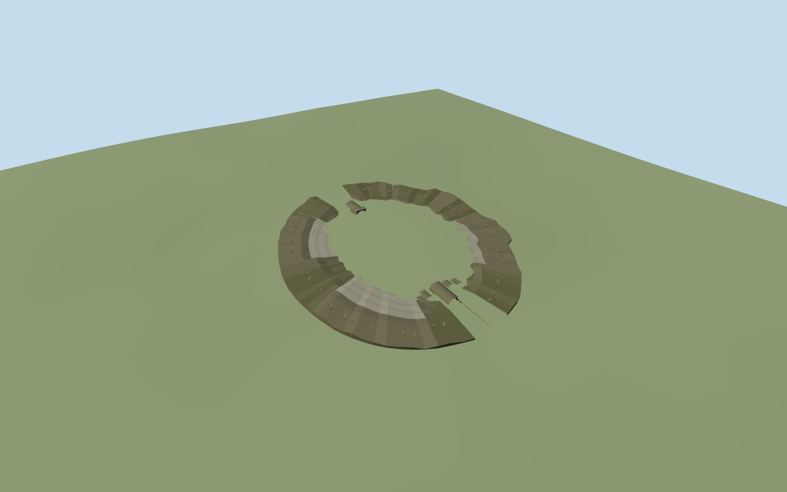

# Amphitheatre of Mérida

Excavated Roman amphitheatre at Mérida with weathered lower granite terraces, a sunken central pit and vaulted axial entrances.

Authoring state: **review-in-qa.json**. Current completion evidence is in [qa.json](qa.json) and the [completion ledger](../../../../qualla-structures/batches/qualla-003.PROGRESS.md).

- [Amphitheatre of Mérida](https://qualla.com/amphitheatre-of-merida/)

The outline and podium assembly retain the named archaeology’s mapped dimensions. The partially fallen upper masonry, exposed pit depth, gallery sections, modern repairs and worn stone texture are approximate.

The model represents the excavated remains, including only the visible portions of seating and masonry. The neighboring Roman theatre, circus and Amphitheatre House are separate sites.

The original bare terrain sampling is preserved. A local clearance exposes the arena and its pit where the coarse field cannot resolve the excavation.

Build: `node content/worldgen/source/places/ey/eyg/amphitheatre_of_merida/models/generate-amphitheatre-of-merida.mjs`. Add `--check` to verify exact regeneration. 5273 triangles; 5 materials; no embedded photographs.
